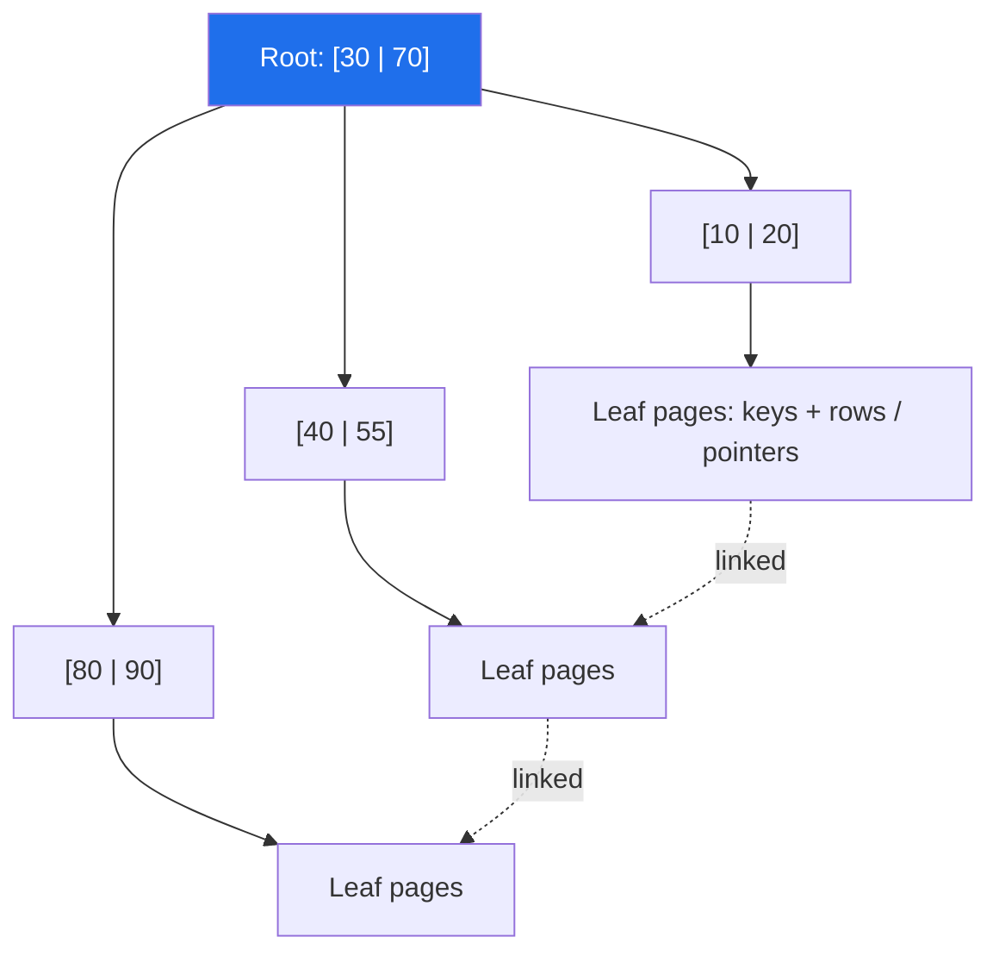
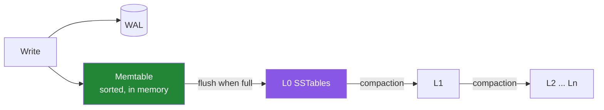

# B-Trees vs LSM Trees: How Databases Actually Store Data

Under the SQL and NoSQL labels from our October post, almost every database stores data with one of two structures: the **B-tree**, which updates data in place, or the **LSM tree**, which appends new data and merges it later. Which one a database uses explains most of its performance profile: fast writes or fast reads, predictable latency or background compaction spikes.

---

## The One-Sentence Difference

- **B-tree:** find the page where the key belongs and **modify it in place**.
- **LSM tree:** **append** the write to memory, flush it to immutable sorted files, and **merge** those files in the background.

| | B-tree | LSM tree |
|---|---|---|
| Write path | Random page writes | Sequential appends |
| Read path | One tree traversal | Memtable plus several files (helped by Bloom filters) |
| Strength | Reads, range scans, predictable latency | High write throughput, compression |
| Cost | Write amplification from page rewrites, fragmentation | Compaction CPU/IO, read and space amplification |

---

## Both Start with the WAL

Before touching the main structure, both log the change to a **write-ahead log** (WAL) and fsync it. After a crash, replaying the WAL restores committed writes. The WAL is also what CDC tools like Debezium read (covered in our Outbox/CDC post).

---

## B-Trees (B+Trees)

- Fixed-size **pages** (8 KB in PostgreSQL, 16 KB in InnoDB). Each node has hundreds of children, so even billions of rows need only **3–4 levels**.
- **B+trees** keep data only in the leaves and link the leaves together, which makes range scans a sequential walk.
- Writes rewrite whole pages. A full page **splits**. Deletes leave gaps that need `VACUUM`, `OPTIMIZE` or page merging.

**Who uses them:** PostgreSQL (heap + B-tree indexes), MySQL InnoDB (clustered B+tree on the primary key), SQLite, Oracle, SQL Server, LMDB, MongoDB's WiredTiger (B-tree by default).

**InnoDB detail:** the table *is* the primary-key B+tree. A random UUIDv4 primary key causes page splits all over the index, while a sequential key (auto-increment, UUIDv7) always appends to the right edge.

---

## LSM Trees (Log-Structured Merge)

- **Memtable**: an in-memory sorted structure (often a skip list). Writes are fast because nothing is read first.
- **SSTables**: immutable sorted files. An update is just a newer version of the key, and a delete writes a **tombstone**.
- **Reads** check the memtable first, then SSTables from newest to oldest. Per-file **Bloom filters** skip files that definitely don't contain the key, and sparse indexes find the right block.
- **Compaction** merges files, drops overwritten values and expired tombstones, and keeps the number of files a read has to check under control.

Origin: O'Neil et al., [*The Log-Structured Merge-Tree*](https://www.cs.umb.edu/~poneil/lsmtree.pdf) (1996). It became widely known through Google's **Bigtable** (2006).

**Who uses them:** RocksDB, LevelDB, Cassandra, ScyllaDB, HBase, Bigtable, CockroachDB (Pebble), TiKV, YugabyteDB (DocDB, built on RocksDB), InfluxDB (TSM, an LSM variant), and MyRocks (MySQL on RocksDB). ClickHouse's MergeTree uses a similar merge-in-the-background idea.

### Compaction strategies

| Strategy | How | Good for |
|---|---|---|
| **Size-tiered** (Cassandra STCS) | Merge files of similar size | Write-heavy workloads; needs extra disk space |
| **Leveled** (RocksDB default, Cassandra LCS) | Each level ~10× the previous, no overlapping key ranges inside a level | Read-heavy; less space amplification |
| **Time-window** (Cassandra TWCS) | Compact only within time buckets | Time series with TTLs |
| **Unified** (Cassandra 5 UCS) | One tunable strategy between tiered and leveled | Mixed workloads |

---

## The Three Amplifications

No engine is best on all three. This is the [RUM conjecture](https://openproceedings.org/2016/conf/edbt/paper-12.pdf): **R**ead, **U**pdate and **M**emory overhead, where improving two worsens the third.

| | Meaning | B-tree | LSM |
|---|---|---|---|
| **Write amplification** | Bytes written to disk per byte of user data | Page rewrites (a whole page for a small row) | Same data rewritten across compaction levels |
| **Read amplification** | Disk reads per lookup | Low (tree height) | Higher (several files), reduced by Bloom filters and caches |
| **Space amplification** | Disk used ÷ live data | Fragmentation and page slack | Stale versions and tombstones until compaction |

---

## Practical Consequences

- **Write-heavy ingestion** (events, metrics, IoT, logs) → an LSM engine.
- **Read-heavy OLTP with range queries and steady latency** → a B-tree engine.
- **Lots of deletes on LSM** → watch for tombstone build-up. Cassandra warns about, and eventually fails, queries that scan too many tombstones.
- **LSM latency spikes** usually come from compaction falling behind: plan for IO headroom and monitor pending compactions.
- **SSDs** favour LSM's sequential writes and lower write amplification, which also means less flash wear.
- **Primary key choice** matters a lot for clustered B-trees. Prefer time-ordered IDs such as UUIDv7.

---

## References

- P. O'Neil et al., [The Log-Structured Merge-Tree](https://www.cs.umb.edu/~poneil/lsmtree.pdf), Acta Informatica 1996
- R. Bayer, E. McCreight, *Organization and Maintenance of Large Ordered Indexes*, 1972 (the original B-tree)
- Athanassoulis et al., [Designing Access Methods: The RUM Conjecture](https://openproceedings.org/2016/conf/edbt/paper-12.pdf), EDBT 2016
- [RocksDB Wiki — Compaction](https://github.com/facebook/rocksdb/wiki/Compaction) · [Leveled Compaction](https://github.com/facebook/rocksdb/wiki/Leveled-Compaction)
- [Apache Cassandra — Compaction](https://cassandra.apache.org/doc/latest/cassandra/managing/operating/compaction/index.html)
- [PostgreSQL — B-Tree Indexes](https://www.postgresql.org/docs/current/btree.html) · [WAL](https://www.postgresql.org/docs/current/wal-intro.html)
- [MySQL — InnoDB Clustered and Secondary Indexes](https://dev.mysql.com/doc/refman/8.4/en/innodb-index-types.html)
- Martin Kleppmann, *Designing Data-Intensive Applications* (O'Reilly), ch. 3
