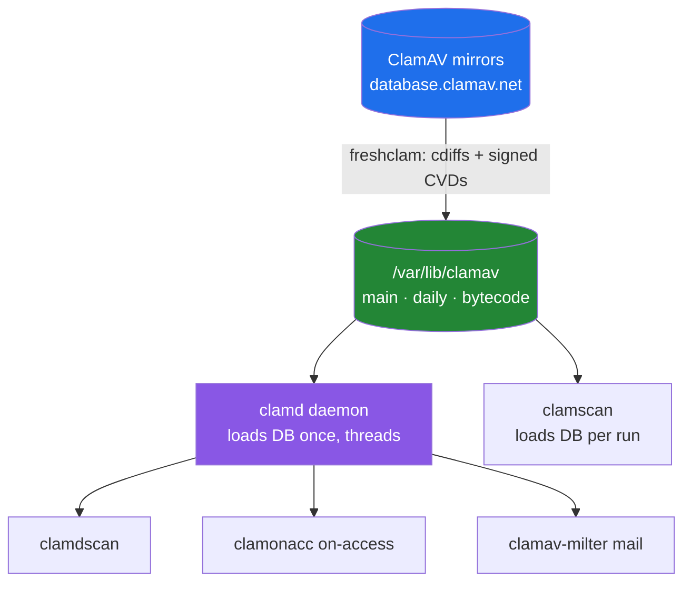

# ClamAV: From Terminal to Kubernetes

ClamAV is the open-source (GPLv2) antivirus toolkit maintained by Cisco Talos — originally built to scan mail at the gateway, now used everywhere from a laptop `clamscan` to a Kubernetes sidecar that scans every upload. It is free, scriptable, has no account or licence server, and detects millions of viruses, worms, trojans, macro viruses, phishing URLs and unwanted applications.

It is also honest about what it is: a **signature-and-heuristic scanner**, not an EDR. Its job is to scan bytes you hand it — files, streams, mail, uploads, a filesystem — and answer *is this known-bad?* Here is how it works, how to use it from the terminal, how to run it in Docker and Kubernetes, and how to keep its database fresh without shooting yourself in the foot.

---

## How It Works



- **`libclamav`** is the engine: it identifies the file type, unpacks archives and executables, then matches content against loaded databases.
- **Databases** ship as **CVD** files — digitally-signed containers maintained by Talos (`main.cvd`, `daily.cvd`, `bytecode.cvd`). The signature prevents a tampered database from ever reaching the engine. Local updates land as **`.cld`** files (unpacked/compressed copies) that `freshclam` maintains alongside.
- **Signature formats**: `.ndb` string patterns, `.hdb`/`.hsb` file hashes (MD5 / SHA-256+size), `.ldb` logical signatures, YARA rules, plus `.cfg`/`.ftm` support files. Custom signatures are plain text you drop into the database directory.
- **Bytecode signatures** let Talos distribute small programs (LLVM or a custom interpreter, with a timeout) for detections plain patterns can't express — the reason `Bytecode yes` should stay enabled.
- **Scan pipeline**: magic-based file-type detection → recursive unpacking (Zip, RAR, 7-Zip, tar, gzip, ISO, DMG, MS Office/OLE, PE/ELF/Mach-O, most mail formats) with archive-bomb limits → pattern/hash/bytecode match → verdict.
- **PUA** (potentially unwanted applications) signatures exist but are **off by default**; enable with `DetectPUA yes` if you want adware/joke-tool detections.

Two things follow from this design: matching is only as good as the database freshness, and the engine must load a ~250 MB database set into RAM, which is why memory (not CPU) is the constraint.

### The toolkit

| Program | What it does |
|---|---|
| `clamd` | Multi-threaded scanning daemon; loads the DB once, talks over Unix/TCP socket |
| `clamscan` | One-shot CLI scanner; loads the DB itself every run (slow start) |
| `clamdscan` | Thin client that hands work to a running `clamd` (fast, low memory) |
| `freshclam` | Downloads and updates the official signature databases |
| `clamonacc` | On-access (real-time) scanning on Linux, wired to `clamd` |
| `clamav-milter` | Mail-filtering plugin for Sendmail/milters |
| `clamdtop` | Live monitor for a running `clamd` |
| `sigtool` | Inspect, unpack and craft signatures — the false-positive debugger |
| `clambc` · `clamsubmit` | Bytecode testing · sample submission |

---

## Terminal in Five Minutes

```bash
sudo apt install clamav clamav-daemon clamav-freshclam   # Debian/Ubuntu
sudo freshclam                                           # first: pull the database
clamscan -r ~/Downloads                                   # scan one-shot
echo -n 'X5O!P%@AP[4\PZX54(P^)7CC)7}$EICAR-STANDARD-ANTIVIRUS-TEST-FILE!$H+H*' | clamscan -
```

The second command is **EICAR** — a harmless industry-standard test string that *every* scanner is required to flag; perfect for proving a pipeline works. `clamscan` exit codes are the contract for automation: **0 = clean, 1 = virus found, 2 = error**.

Flags worth knowing:

```bash
clamscan -r -i -l scan.log /var/www           # only print infected, log everything
clamscan --move=/quarantine /var/www          # move detections aside
clamscan --fail-if-cvd-older-than=7 /var/www  # fail if DB older than 7 days (staleness guard)
clamscan --gen-json --leave-temps sample.bin  # machine-readable detail for pipelines
```

`clamscan` reloading the database on every invocation is fine for cron jobs and one-offs, but wasteful for a service. Keep `clamd` running instead and scan through it:

```bash
sudo systemctl enable --now clamav-daemon
clamdscan --multiscan --fdpass ~/Downloads   # thread per core; fd-pass for unreadable paths
clamdscan --stream < upload.bin              # submit from another machine/pipe (slower)
clamdscan --reload                           # tell clamd to reload the database now
```

**Expert:** `--fdpass` passes file descriptors, so `clamd` can scan files the daemon user could not open by path — the usual fix for "lstat() failed: Permission denied" in CI. And `clamd` re-checks the database directory on its own schedule, so even without `--reload` it picks up new signatures within minutes.

---

## Docker

Cisco publishes official images: `clamav/clamav` (Alpine) and `clamav/clamav-debian`, each in two flavours:

- `clamav/clamav:<version>` — **preloaded** with a signature database (convenient, but the image grows with every publish).
- `clamav/clamav:<version>_base` — **no database**; pair it with a volume under `/var/lib/clamav`.

**Expert:** pick a *feature* tag (`1.4`), which tracks the latest patched patch release and keeps receiving signature updates — never a `-R` build-revision tag, which is frozen forever. After a feature release reaches end-of-life, its images stop getting signature updates entirely.

The container starts **both `clamd` and the `freshclam` daemon** by default (milter stays off), so updates happen without extra work:

```bash
docker volume create clam_db
docker run -d --name clamav -p 3310:3310 \
  -v clam_db:/var/lib/clamav \
  clamav/clamav:1.4
```

Scan a mounted directory, and run unprivileged when you can:

```bash
docker run --rm -v "$PWD":/scandir clamav/clamav:1.4 clamscan -r /scandir

docker run --rm --user clamav --entrypoint /init-unprivileged \
  -v clam_db:/var/lib/clamav clamav/clamav:1.4_base
```

Environment variables are the control panel:

| Variable | Effect |
|---|---|
| `CLAMAV_NO_FRESHCLAMD=true` | Don't run the updater (use one updater for many scanners) |
| `CLAMAV_NO_CLAMD=true` | Don't run `clamd` (updater-only / `clamscan`-only container) |
| `FRESHCLAM_CHECKS=4` | Update-checks per day (default 1) |
| `CLAMD_CONF_LogTime=no` | Any `clamd.conf` setting, generated on startup |
| `FRESHCLAM_CONF_Checks=24` | Any `freshclam.conf` setting, same mechanism |
| `CLAMD_STARTUP_TIMEOUT=1800` | Seconds to wait for `clamd` while it loads the DB |

Ports: **3310** for `clamd`, **7357** for the milter. Both are plain, **unauthenticated, unencrypted** protocols — they are for trusted networks only. A built-in health check pings `clamd`; budget **3 GiB RAM minimum, 4 GiB preferred** for the database load test.

---

## Kubernetes with Helm

You do not need to hand-roll manifests — several maintained charts deploy the official image:

```bash
# Wiremind chart (official image, Deployment + Service)
helm repo add wiremind https://wiremind.github.io/wiremind-helm-charts
helm install clamav wiremind/clamav

# xrow chart via OCI (daily-updated image + built-in EICAR helm test)
helm upgrade --install clamav \
  oci://registry.gitlab.com/xrow-public/helm-clamav/charts/clamav \
  --create-namespace -n clamav
```

The **fairwinds-incubator** chart shows the other archetype: a `Deployment` running the `clamd` *server*, plus a `DaemonSet` scanner that runs `clamdscan` against it with the host filesystem mounted — cluster-wide node scanning rather than per-app scanning.

Whatever chart you use, the values that matter are the same (key names vary slightly by chart):

```yaml
persistence:
  enabled: true      # PVC on /var/lib/clamav — otherwise every restart re-downloads ~250 MB
  size: 2Gi
resources:
  requests: { memory: 3Gi, cpu: 250m }
  limits:   { memory: 4Gi }
```

Two Kubernetes-specific cautions:

- **The database volume is the whole game.** Without it, every pod start re-downloads the full database set and the pod takes many minutes to become ready. Persist `/var/lib/clamav`.
- **Port 3310 is unauthenticated.** Keep the service `ClusterIP`, never expose it through an Ingress/LoadBalancer, and lock it down with a `NetworkPolicy` allowing only the namespaces that scan uploads. For same-pod scanning, share the `clamd` Unix socket through an `emptyDir` volume instead of using TCP at all.

Charts that ship a test (xrow does) run it with `helm test <release>` — it fires the EICAR string and confirms a detection, which is the fastest smoke test for a fresh cluster.

---

## Keeping the Database Fresh (the Part People Get Wrong)

The official database is updated many times a week, sometimes daily. A week-old database is an antivirus that recognises last week's threats.

`freshclam` handles this: it first does a cheap DNS version check, then downloads **cdiffs** (scripted differential updates) against the mirrors, verifies MD5 *and* the digital signature, and falls back to a full re-download if a local database looks corrupted. Pick whichever automation style fits:

```bash
# 1. Cron: one-shot, quiet, every 4 hours
0 */4 * * * /usr/bin/freshclam --quiet

# 2. Daemon: 24 checks/day, runs in the foreground
freshclam -d --check=24

# 3. Distribution service/timer (Debian/Ubuntu ships this)
sudo systemctl enable --now clamav-freshclam
```

Wire update outcomes into your monitoring instead of trusting silence:

```bash
freshclam --quiet --on-update-execute=/usr/local/bin/reload-clamd.sh
```

freshclam's return codes are granular enough for alerting: **0** up to date, **52** network problem, **54** signature verification failure, **59** mirrors out of sync. Combine `--on-error-execute` for paging with `clamscan --fail-if-cvd-older-than=N` in a nightly job so a stalled updater actually fails a check instead of going unnoticed.

**Reload semantics.** `clamd` periodically re-reads the database directory and hot-reloads new signatures; to force it immediately after a manual update, run `clamdscan --reload`. In Docker the updater daemon runs by default; in Kubernetes let exactly one updater write to the shared PVC (`CLAMAV_NO_FRESHCLAMD=true` everywhere else) — multiple `freshclam` processes against one volume just race and waste bandwidth.

Beyond the official mirrors:

- **`ExtraDatabase`** in `freshclam.conf` pulls additional databases distributed through the ClamAV mirrors.
- **`DatabaseCustomURL`** accepts any `http(s)://`, `ftp(s)://` or `file://` source — the hook for your own `.ndb`/`.hdb` signatures.
- **Third-party sets** (Sanesecurity phishing/spam signatures, SecuriteInfo, URLhaus, OITC Winnow, and similar) add large detection gains for mail and web content. The long-standing helper for them is `clamav-unofficial-sigs`, which downloads, tests, and updates those databases — and provides `--whitelist '<Sig.Name>'` (`.ign2`) to suppress a false positive durably.
- **Air-gapped networks**: run a private mirror, or replicate the database directory by rsync/artifact and point `freshclam` at it (`PrivateMirror`) or a `file://` `DatabaseCustomURL`.

**Expert trade-off:** `TestDatabases yes` (default) makes `freshclam` load each new database into memory before replacing the old one, which is why updates cost RAM. Setting it to `no` saves memory but risks keeping a broken download that then makes `clamd` fail to reload — keep it on unless memory is genuinely scarce.

---

## Expert Gotchas

- **Memory, not CPU, is the limit.** Plan for 3–4 GiB per scanning container; set the pod's memory *request* accordingly so the kernel doesn't OOM-kill `clamd` mid-scan.
- **First start is slow on purpose.** A cold container downloads ~250 MB and then load-tests it. `CLAMD_STARTUP_TIMEOUT` exists precisely for this; don't set a 30-second Kubernetes probe on a fresh database volume.
- **TCP 3310 has no authentication or TLS.** Anything on the network that can reach it can scan, and the connection is readable. NetworkPolicy or Unix socket, always.
- **Ownership of a bind-mounted database directory gets rewritten** to the container's `clamav` user — fine on a dedicated host directory, surprising if you bind-mount somewhere shared.
- **EOL follows the engine, not just the image.** Old feature releases lose signature updates; pin a feature tag and upgrade it on ClamAV's schedule, not your convenience.
- **False positives are a workflow, not an emergency.** Use `sigtool --unpack` (or `--find="Sig.Name"`) to identify the offending signature, then whitelist it with an `.ign2` entry — and report it upstream so it gets fixed.
- **Be a good citizen with bandwidth.** Don't re-download the full database set on every container start; use a persisted volume and cdiff updates. The project literally asks for this in its docs.
- **Test with EICAR, never with real malware.** It is the accepted, safe proof-of-detection in CI, Helm tests, and acceptance checks.

---

**References**

- [ClamAV Documentation — Introduction](https://docs.clamav.net/)
- [Usage: Daemon, Scanner and Tools](https://docs.clamav.net/manual/Usage.html)
- [Scanning](https://docs.clamav.net/manual/Usage/Scanning.html)
- [Signatures and Database Formats](https://docs.clamav.net/manual/Signatures.html)
- [Updating Signature Databases (freshclam)](https://docs.clamav.net/manual/Usage/SignatureManagement.html)
- [ClamAV in Docker](https://docs.clamav.net/manual/Installing/Docker.html) · [clamav-docker README](https://github.com/Cisco-Talos/clamav-docker)
- [freshclam(1)](https://manpages.debian.org/unstable/clamav-freshclam/freshclam.1.en.html) · [clamscan(1)](https://manpages.debian.org/unstable/clamav/clamscan.1.en.html)
- [Helm: Wiremind ClamAV](https://artifacthub.io/packages/helm/wiremind/clamav) · [Helm: xrow ClamAV](https://artifacthub.io/packages/helm/clamav/clamav) · [Helm: fairwinds-incubator ClamAV](https://artifacthub.io/packages/helm/fairwinds-incubator/clamav)
- [Sanesecurity Signatures](https://sanesecurity.com/usage/signatures) · [clamav-unofficial-sigs](https://github.com/extremeshok/clamav-unofficial-sigs)
