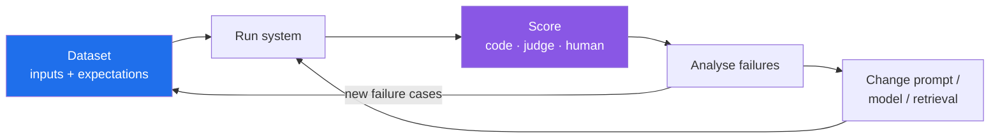

# Evaluating LLM Systems: Evals, LLM-as-Judge and Regression Testing

"It looked good when I tried it" is how most LLM features ship, and why they regress silently when someone changes a prompt, swaps a model or re-chunks a RAG index. **Evals** are the unit and integration tests of LLM systems: a fixed dataset, a scoring method, and a number you can compare across changes.

---

## Why Normal Tests Aren't Enough

| Traditional code | LLM system |
|---|---|
| Deterministic | Non-deterministic. The same input can give different outputs |
| One correct answer | Many acceptable answers |
| `assertEquals` | Needs semantic or rubric-based scoring |
| Changes come from your code | Changes also come from model versions, prompts, retrieved data |

You still write normal tests for the deterministic parts (parsing, tool wiring, output schemas). Evals cover what's left.

---

## The Eval Loop



1. **Define success first.** Make it specific and measurable, e.g. "answers cite a source document; under 5% unsupported claims". Anthropic's guide starts with [defining success criteria](https://docs.claude.com/en/docs/test-and-evaluate/define-success).
2. **Build a dataset** from real traffic, known edge cases and past bugs. 50–200 well-chosen cases beat 10,000 synthetic ones.
3. **Score** with the cheapest method that works.
4. **Read the failures.** The aggregate number tells you *whether* something changed. The individual failures tell you *why*.
5. **Turn every production bug into a new case.** That's regression testing.

---

## Scoring Methods: Cheapest First

| Method | Use for | Example |
|---|---|---|
| **Exact / programmatic** | Classification, extraction, structured output | Label matches; JSON validates; SQL returns the right rows |
| **Heuristics** | Format and constraints | Length, required citation present, no banned phrases |
| **Reference similarity** | Answers with a known gold answer | Embedding similarity, ROUGE/BLEU (weak signals) |
| **LLM-as-judge** | Open-ended quality | Rubric: "Is the answer fully supported by the context? yes/no + reason" |
| **Human review** | Calibrating judges, high-stakes domains | Expert grading of a sample |

**Rule:** use code wherever you can. A test that checks `json.loads(output)["status"] == "refund"` is free and never drifts.

---

## LLM-as-Judge: Useful, Biased, Calibrate It

Using a strong model to grade outputs scales well and agrees reasonably with humans. [Zheng et al. (MT-Bench, 2023)](https://arxiv.org/abs/2306.05685) found GPT-4 judgements matched human preferences about as often as humans matched each other. They also documented these biases:

| Bias | Mitigation |
|---|---|
| **Position bias**: prefers the first (or second) answer | Swap the order and judge twice |
| **Verbosity bias**: prefers longer answers | Rubric explicitly rewards brevity and correctness |
| **Self-preference**: prefers its own model family's style | Judge with a different model family |
| **Leniency / inconsistency** | Binary or small-scale rubrics, low temperature, ask for reasoning before the score |

Good judge prompts:

```text
You are grading a support answer.
Context: {retrieved_docs}
Answer: {answer}

Criteria (answer each YES/NO with one sentence of reasoning):
1. Every factual claim is supported by the context.
2. The answer addresses the user's actual question.
3. No policy or pricing is invented.
Return JSON: {"supported": bool, "on_topic": bool, "no_invention": bool, "reasons": [...]}
```

**Calibrate**: have humans grade 50–100 samples, measure how often the judge agrees, and fix the rubric until agreement is high. Re-check whenever you change the judge model.

---

## RAG Evals: Score Retrieval and Generation Separately

When a RAG answer is wrong, find out which half failed. (Our May post covered RAG itself.)

| Stage | Metric | Question |
|---|---|---|
| Retrieval | **Context recall / precision**, hit rate, MRR | Did we fetch the right chunks? Ranked high enough? |
| Generation | **Faithfulness / groundedness** | Is every claim supported by the retrieved context? |
| Generation | **Answer relevance** | Does it answer the question that was asked? |
| End to end | **Correctness** vs a gold answer | Is it actually right? |

[Ragas](https://docs.ragas.io/) implements these metrics. Retrieval metrics are cheap to compute, so measure them on every index or chunking change.

---

## Agent Evals: Outcome and Trajectory

Agents take many steps, so evaluate both:

- **Outcome**: did the final state meet the goal? Tests pass, ticket resolved, correct DB state. Prefer checking the *environment* rather than reading the transcript.
- **Trajectory**: right tools, sensible order, no forbidden actions, reasonable number of steps and cost.
- **Run each case several times.** Agents are stochastic. Report pass rate (pass@k, or pass^k for reliability), not a single run.
- **Sandbox the environment** so that runs are reproducible and safe. [Inspect AI](https://inspect.aisi.org.uk/) (UK AI Security Institute) and [SWE-bench](https://www.swebench.com/) are well-known reference setups.

---

## Evals in CI

Treat prompts and model versions like code:

```yaml
# promptfoo-style config: runs on every PR that touches prompts/
prompts: [file://prompts/support.txt]
providers: [anthropic:messages:claude-sonnet-5-5]
tests:
  - vars: { question: "Can I get a refund after 40 days?" }
    assert:
      - type: contains
        value: "30 days"
      - type: llm-rubric
        value: "Does not promise a refund; cites the refund policy"
```

- **Gate on regressions**, not on absolute scores: fail the PR if the pass rate drops by more than X compared with main.
- **Pin model versions.** "Latest" aliases make your eval history impossible to compare.
- **Keep a holdout set** that you don't tune prompts against, to catch overfitting.
- **Monitor online too.** Sample production traffic, run the same judges on it, and track user feedback signals (our observability post applies).

Common tools: [promptfoo](https://www.promptfoo.dev/), [OpenAI Evals](https://github.com/openai/evals), [Inspect AI](https://inspect.aisi.org.uk/), [Ragas](https://docs.ragas.io/), DeepEval, and LangSmith / Langfuse for traces and datasets.

---

## Anti-Patterns

- **Vibe evals**: five hand-picked prompts tried in a playground.
- **One aggregate score**: a 2% average gain can hide a 30% drop on one critical category. Slice results by category.
- **Unvalidated judges**: an LLM grader nobody has checked against humans.
- **Testing on the training/tuning set**: prompts tuned until the eval passes, with no holdout.
- **Ignoring cost and latency**: a better answer at 4× the cost or 10 s latency may not be better.

---

## References

- Anthropic, [Define success criteria](https://docs.claude.com/en/docs/test-and-evaluate/define-success) · [Create strong empirical evaluations](https://docs.claude.com/en/docs/test-and-evaluate/develop-tests)
- OpenAI, [Evaluation best practices](https://platform.openai.com/docs/guides/evaluation-best-practices) · [OpenAI Evals](https://github.com/openai/evals)
- Zheng et al., [Judging LLM-as-a-Judge with MT-Bench and Chatbot Arena](https://arxiv.org/abs/2306.05685), NeurIPS 2023
- Es et al., [RAGAS: Automated Evaluation of Retrieval Augmented Generation](https://arxiv.org/abs/2309.15217) · [Ragas docs](https://docs.ragas.io/)
- UK AI Security Institute, [Inspect AI](https://inspect.aisi.org.uk/) · [SWE-bench](https://www.swebench.com/)
- [promptfoo docs](https://www.promptfoo.dev/docs/intro/)
- Hamel Husain, [Your AI Product Needs Evals](https://hamel.dev/blog/posts/evals/)
