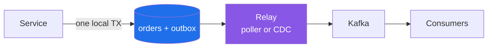
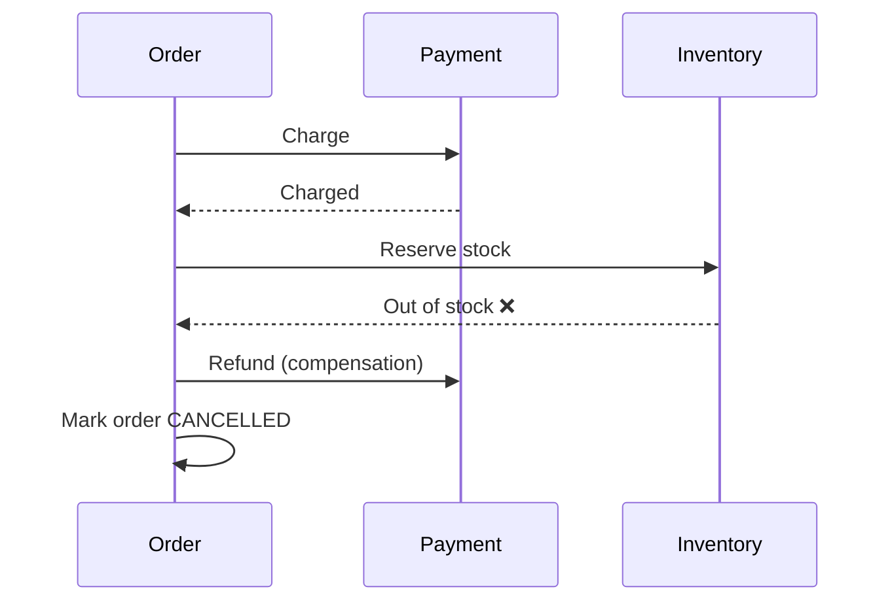

# Outbox, Saga and CDC: Consistency Without Distributed Transactions

A service saves an order and then publishes `OrderCreated`. Two systems, two writes, no shared transaction. Sooner or later one write succeeds and the other fails. This is the **dual-write problem**, and the patterns below are the standard ways to deal with it.

Our August post on Paxos and Raft covered how nodes **agree**. This one covers how **services** stay consistent when they can't agree in one transaction.

---

## The Dual-Write Problem

```java
@Transactional
public void placeOrder(Order o) {
    orders.save(o);                       // 1. DB commit
    kafka.send("orders", new OrderCreated(o)); // 2. broker
}
```

| Failure | Result |
|---|---|
| DB commits, publish fails | Order exists, and nobody downstream knows |
| Publish succeeds, DB rolls back | Downstream acts on an order that doesn't exist |
| Publish times out but actually succeeded | A retry sends a duplicate |

Two-phase commit (XA) across a database and a broker is slow, fragile and mostly unsupported by modern brokers. The patterns below replace it.

---

## 1. Transactional Outbox

Write the event to an **outbox table in the same local transaction** as the business data. A separate process publishes it later.



```sql
CREATE TABLE outbox (
  id             UUID PRIMARY KEY,
  aggregate_type TEXT,
  aggregate_id   TEXT,
  type           TEXT,
  payload        JSONB,
  created_at     TIMESTAMPTZ DEFAULT now()
);
```

Both rows commit or neither does. Publishing becomes **at-least-once**, so consumers must handle duplicates (see Idempotency below).

**Relay options:**
- **Polling publisher**: a scheduled job reads unsent rows and marks them sent. Simple, but adds latency and load on the DB.
- **Log tailing (CDC)**: read the database's transaction log. See below.
- **[Spring Modulith](https://docs.spring.io/spring-modulith/reference/events.html)**: its *Event Publication Registry* persists application events alongside your transaction and can publish them to Kafka, AMQP and other brokers. You get the outbox without writing it yourself.

---

## 2. Change Data Capture (CDC)

CDC reads the database's own transaction log (PostgreSQL WAL, MySQL binlog) and turns committed changes into events.

| | Polling | CDC (log-based) |
|---|---|---|
| Latency | Poll interval | Near real time |
| DB load | Repeated queries | Reads the log |
| Captures deletes | Only with soft deletes | Yes |
| Ops cost | Low | Connector plus log retention to manage |

**[Debezium](https://debezium.io/)** is the standard open-source CDC platform, usually running on Kafka Connect. Its [Outbox Event Router](https://debezium.io/documentation/reference/stable/transformations/outbox-event-router.html) combines both patterns: tail the outbox table and route each row to a topic chosen by `aggregate_type`.

**Outbox + CDC beats raw CDC on business tables.** Publishing table rows directly leaks your internal schema as a public contract. The outbox lets you publish intentional domain events.

---

## 3. Saga

A business process that spans services, such as order → payment → stock → shipping, can't be one ACID transaction. A **saga** ([Garcia-Molina & Salem, 1987](https://www.cs.cornell.edu/andru/cs711/2002fa/reading/sagas.pdf)) runs it as a sequence of local transactions. If a step fails, **compensating transactions** undo the earlier steps.



| Style | How | Pros | Cons |
|---|---|---|---|
| **Choreography** | Each service reacts to the others' events | No central component, loose coupling | Flow is hard to see; cyclic dependencies |
| **Orchestration** | A coordinator tells each service what to do next | Explicit flow, easy to monitor and change | The orchestrator is one more service to own |

Orchestration engines such as **[Temporal](https://temporal.io/)** and **Camunda** store the saga's state durably, so a crash mid-saga resumes instead of leaving things half done.

**Saga rules:**
- Compensations are *semantic* undos, such as a refund or a cancellation, not rollbacks. Some steps can't be undone at all, like a sent email. Put those last.
- Sagas don't give you isolation. Other requests can see intermediate states, so use explicit states like `PENDING` and semantic locks.
- Every step and every compensation must be idempotent and safe to retry.

---

## 4. Idempotency: The Part Everything Depends On

At-least-once delivery means duplicates *will* arrive. Make processing the same message twice harmless:

```java
@Transactional
public void on(PaymentCaptured e) {
    if (!processed.insertIfAbsent(e.eventId())) return; // inbox / dedup table
    orders.markPaid(e.orderId());
}
```

- **Inbox table**: store processed message IDs in the same transaction as the side effect.
- **Idempotency keys** on APIs: the client sends `Idempotency-Key`, and the server returns the stored result on a retry ([Stripe's approach](https://docs.stripe.com/api/idempotent_requests)).
- **Natural idempotency**: `SET status = 'PAID'` is safe to repeat, while `balance = balance - 10` is not.
- **Ordering**: partition by aggregate ID so that events for one order stay in order.

### What about "exactly-once"?

Kafka's [exactly-once semantics](https://kafka.apache.org/documentation/#semantics) (idempotent producer plus transactions) holds **within Kafka**: read, process and write between topics. Once a side effect leaves Kafka (a DB write, an email, an HTTP call), you're back to **at-least-once delivery plus idempotent processing**. That combination is what "effectively once" really means.

---

## Choosing

| Need | Use |
|---|---|
| Publish an event reliably when data changes | **Outbox** (with polling, CDC or Spring Modulith) |
| Stream DB changes to search, cache or analytics | **CDC** (Debezium) |
| A multi-step business process across services | **Saga**: choreography for 2–3 steps, orchestration beyond that |
| Any consumer, always | **Idempotency** |

---

## References

- Chris Richardson, microservices.io: [Transactional Outbox](https://microservices.io/patterns/data/transactional-outbox.html) · [Saga](https://microservices.io/patterns/data/saga.html) · [Idempotent Consumer](https://microservices.io/patterns/communication-style/idempotent-consumer.html)
- [Debezium docs](https://debezium.io/documentation/) · [Outbox Event Router](https://debezium.io/documentation/reference/stable/transformations/outbox-event-router.html)
- [Spring Modulith — Application Events & Event Publication Registry](https://docs.spring.io/spring-modulith/reference/events.html)
- [Apache Kafka — Message Delivery Semantics](https://kafka.apache.org/documentation/#semantics)
- H. Garcia-Molina, K. Salem, [Sagas](https://www.cs.cornell.edu/andru/cs711/2002fa/reading/sagas.pdf), SIGMOD 1987
- [Temporal docs](https://docs.temporal.io/) · [Stripe — Idempotent requests](https://docs.stripe.com/api/idempotent_requests)
- Martin Kleppmann, *Designing Data-Intensive Applications* (O'Reilly), ch. 11–12
