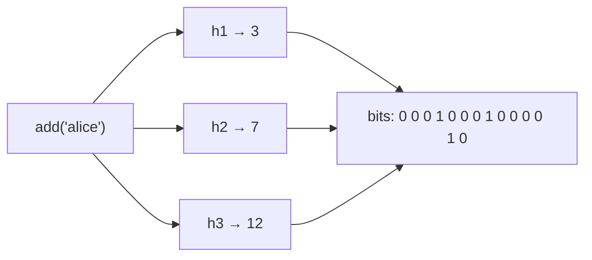

# Probabilistic Data Structures: Bloom, HyperLogLog, Count-Min

"Have we seen this before?" "How many unique users today?" "What are the top 10 URLs?" With billions of items, exact answers need memory that grows with the data. **Probabilistic data structures** answer in a **fixed, tiny amount of memory**, with a small, known error.

---

## The Family at a Glance

| Structure | Answers | Error | Memory example |
|---|---|---|---|
| **Bloom filter** | Is X in the set? | False positives, **never** false negatives | ~1.2 MB for 1M items at 1% |
| **Cuckoo filter** | Is X in the set? (supports delete) | False positives | Similar to Bloom, better at low error rates |
| **HyperLogLog** | How many *distinct* items? | ~0.81% standard error | **12 KB** for billions (Redis) |
| **Count-Min Sketch** | How often did X occur? | Overestimates only | Fixed width × depth |
| **Top-K / heavy hitters** | Which items occur most? | Approximate counts | Fixed |
| **t-digest** | p50 / p99 / p99.9 of a stream? | Very accurate at the tails | A few KB |
| **MinHash** | How similar are two sets? | Estimate of Jaccard similarity | k hashes per set |

---

## 1. Bloom Filter: "Definitely Not" or "Probably Yes"

A bit array of size `m` and `k` hash functions ([Bloom, 1970](https://dl.acm.org/doi/10.1145/362686.362692)).



- **Add:** set the `k` bits.
- **Query:** if any of the `k` bits is 0, the item is **definitely not** in the set. If all are 1, it **probably** is.
- **Sizing:** about **9.6 bits per item for a 1% false-positive rate**, with `k ≈ (m/n)·ln 2` (≈7). Each 10× reduction in error costs about 4.8 more bits per item.
- **No deletes** (clearing a bit could remove other items). Counting Bloom filters and Cuckoo filters fix that.

**Used by:** RocksDB, Cassandra and HBase, with one filter per SSTable to skip disk reads (see our December storage-engines post); PostgreSQL's `bloom` index; CDNs avoiding caching one-hit wonders; databases avoiding pointless lookups in hash joins.

```java
// Guava
BloomFilter<String> seen = BloomFilter.create(
        Funnels.stringFunnel(StandardCharsets.UTF_8), 1_000_000, 0.01);
seen.put("alice");
seen.mightContain("bob");   // false → definitely not seen
```

**Cuckoo filter** ([Fan et al., 2014](https://www.cs.cmu.edu/~dga/papers/cuckoo-conext2014.pdf)) stores small fingerprints in a cuckoo hash table: it supports deletes and uses less space than Bloom below roughly 3% error.

---

## 2. HyperLogLog: Counting Distinct Things

Hash every item and look at the number of **leading zeros**. Seeing a hash with 20 leading zeros suggests you've seen around 2²⁰ distinct items. One observation is noisy, so HLL splits the hash space into many **registers**, keeps the maximum per register, and combines them with a harmonic mean ([Flajolet et al., 2007](https://algo.inria.fr/flajolet/Publications/FlFuGaMe07.pdf)).

- **Fixed memory**: Redis uses 12 KB with 0.81% standard error, whether you count a thousand or a billion items.
- **Mergeable**: HLL(Monday) ∪ HLL(Tuesday) = unique users over both days, *without* the raw data. Daily sketches roll up into weekly and monthly ones.
- **Cannot** list the items or remove one.

```text
PFADD visitors:2027-01-15 user:42 user:99 user:42
PFCOUNT visitors:2027-01-15            → 2
PFMERGE visitors:week visitors:2027-01-15 visitors:2027-01-16
```

**Used by:** Redis (`PF*` commands), BigQuery `APPROX_COUNT_DISTINCT` (HLL++), Trino/Presto `approx_distinct`, the Elasticsearch `cardinality` aggregation, Apache DataSketches, Spark `approx_count_distinct`.

---

## 3. Count-Min Sketch: How Often?

A `depth × width` table of counters with one hash function per row ([Cormode & Muthukrishnan, 2005](https://www.cs.tufts.edu/~nr/cs257/archive/graham-cormode/count-min.pdf)).

- **Add X:** increment one counter in each row.
- **Estimate X:** take the **minimum** across rows. Collisions only *add*, so the estimate never undercounts.
- Error depends on width and confidence on depth, never on the number of distinct items.

**Use for:** rate limiting and abuse detection by IP, trending hashtags, heavy-hitter detection in network traffic. Combined with a small heap it gives **Top-K**: Redis `TOPK.*`, which uses HeavyKeeper.

---

## 4. t-digest: Percentiles of a Stream

Averages hide latency problems, so you need p99. Computing it exactly means keeping every value. **t-digest** (Ted Dunning) clusters values into centroids that are **small near the tails** and large in the middle. That makes p99 and p99.9 very accurate in a few KB, and digests from many servers can be merged.

**Used by:** Elasticsearch `percentiles` aggregation, Redis `TDIGEST.*`, Apache DataSketches (alongside its KLL quantile sketch). This is the same problem that the histograms in our August observability post address.

---

## 5. MinHash: Set Similarity

Estimate the **Jaccard similarity** of two sets by comparing their minimum hash values across k hash functions ([Broder, 1997](https://www.cs.princeton.edu/courses/archive/spring13/cos598C/broder97resemblance.pdf)). Combined with **LSH** (locality-sensitive hashing), it finds near-duplicate documents among billions without comparing every pair. Used for web-crawl and LLM training-data deduplication.

---

## When to Use Them (and When Not)

| Use when | Avoid when |
|---|---|
| The data doesn't fit in memory, or is a stream | You need exact answers (billing, balances, compliance) |
| A small error is acceptable (analytics, dashboards, caches) | A false positive is dangerous and has no fallback check |
| You need to merge results across shards or time | The data set is small. Just use a `HashSet` |
| A "definitely not" answer saves an expensive lookup | You need to list or delete individual items (except with Cuckoo) |

**The pattern:** use the sketch as a **cheap filter in front of the exact system**. If the Bloom filter says "maybe", check the database. If it says "no", skip the lookup.

---

## References

- B. H. Bloom, [Space/Time Trade-offs in Hash Coding with Allowable Errors](https://dl.acm.org/doi/10.1145/362686.362692), CACM 1970
- Flajolet et al., [HyperLogLog: the analysis of a near-optimal cardinality estimation algorithm](https://algo.inria.fr/flajolet/Publications/FlFuGaMe07.pdf), 2007 · Heule et al., [HyperLogLog in Practice (HLL++)](https://research.google/pubs/hyperloglog-in-practice-algorithmic-engineering-of-a-state-of-the-art-cardinality-estimation-algorithm/), Google 2013
- Cormode & Muthukrishnan, [An Improved Data Stream Summary: The Count-Min Sketch](https://www.cs.tufts.edu/~nr/cs257/archive/graham-cormode/count-min.pdf)
- Fan et al., [Cuckoo Filter: Practically Better Than Bloom](https://www.cs.cmu.edu/~dga/papers/cuckoo-conext2014.pdf), CoNEXT 2014
- T. Dunning, [Computing Extremely Accurate Quantiles Using t-Digests](https://arxiv.org/abs/1902.04023)
- A. Broder, [On the resemblance and containment of documents](https://www.cs.princeton.edu/courses/archive/spring13/cos598C/broder97resemblance.pdf), 1997
- [Redis — Probabilistic data types](https://redis.io/docs/latest/develop/data-types/probabilistic/) · [Apache DataSketches](https://datasketches.apache.org/) · [Guava BloomFilter](https://guava.dev/releases/snapshot-jre/api/docs/com/google/common/hash/BloomFilter.html)
