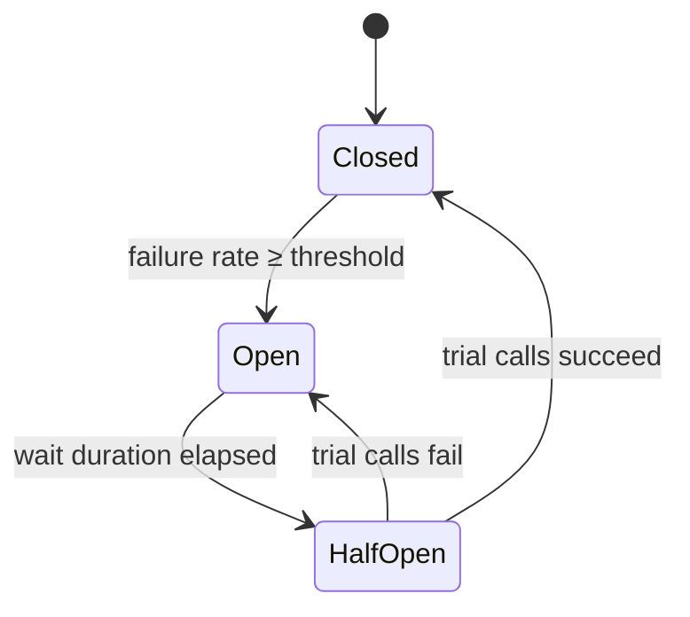

# Resilience Patterns: Timeouts, Retries, Circuit Breakers, Bulkheads

Every remote call can be slow, fail, or succeed after you've given up on it. Resilience patterns keep **one slow dependency from taking the whole system down**. Each one is simple. The hard part is combining them so they don't make an outage worse.

---

## The Failure Chain These Patterns Break


| Pattern | Breaks the chain at |
|---|---|
| **Timeout** | Threads wait forever |
| **Bulkhead** | One dependency exhausting shared resources |
| **Circuit breaker** | Calling something that is known to be broken |
| **Retry (with backoff + jitter)** | Giving up on transient failures. Done badly, it *causes* the "load multiplies" step |
| **Rate limiter / load shedding** | Accepting more work than you can finish |
| **Fallback** | Showing users an error when a degraded answer would do |

---

## 1. Timeouts — Always, Everywhere

A call with no timeout is a resource leak waiting to happen. Many HTTP and JDBC clients default to waiting **forever**.

- Set **connect** and **read/response** timeouts separately.
- Base them on the dependency's measured latency (e.g. p99.9 plus headroom), not round numbers.
- **Propagate deadlines.** If the user's request has 2 s left, a downstream call shouldn't get 5 s. gRPC does this natively with deadlines.

---

## 2. Retries — Useful and Dangerous

Retry only failures that are **transient** (connection reset, 503, 429) and calls that are **idempotent**. Our previous post on Outbox and Saga covers how to make calls idempotent.

**Back off exponentially and add jitter.** Without jitter, every client retries at the same moment and hits the recovering service together. [AWS's analysis](https://aws.amazon.com/builders-library/timeouts-retries-and-backoff-with-jitter/) shows that "full jitter" spreads the load best:

```text
sleep = random(0, min(cap, base * 2^attempt))
```

**Retry amplification.** If each of 5 layers retries 3 times, a single failing call at the bottom becomes up to 4⁵ = **1,024** requests. Rules:

- Retry at **one layer**, usually the one closest to the user or the failure.
- Use a **retry budget** (e.g. retries ≤ 10% of requests) instead of a fixed count per request.
- Honour `Retry-After` on 429 and 503 responses.

---

## 3. Circuit Breaker

Stop calling a dependency that's failing, give it time to recover, then test it carefully ([Fowler](https://martinfowler.com/bliki/CircuitBreaker.html), from Nygard's *Release It!*).



- **Closed**: calls pass through and failures are counted over a sliding window.
- **Open**: calls fail immediately (and go to the fallback). No waiting, no load on the dependency.
- **Half-open**: a few trial calls decide whether to close again.

Count **slow calls** as failures too. A dependency that answers in 30 s is worse than one that's down.

---

## 4. Bulkhead

Named after ship compartments: a leak floods one compartment, not the whole ship.

- **Semaphore bulkhead**: limits concurrent calls to a dependency (e.g. 20).
- **Thread-pool bulkhead**: a separate, bounded pool for each dependency.
- **At the infrastructure level**: separate connection pools, separate deployments for critical vs batch traffic, cell-based architecture.

If the recommendations service hangs, it uses up *its* 20 permits, and checkout keeps working.

---

## 5. Rate Limiting and Load Shedding

- **Rate limiter** (client or server): caps requests per period, e.g. with a token bucket. Protects downstream services and enforces quotas.
- **Load shedding** (server): when overloaded, reject early with a cheap `503` instead of accepting work you'll finish too late to matter. Shed low-priority traffic first ([AWS Builders' Library](https://aws.amazon.com/builders-library/using-load-shedding-to-avoid-overload/)).
- **Hedged requests**: for tail latency, send a second request after the p95 delay and take whichever answers first ([*The Tail at Scale*](https://research.google/pubs/the-tail-at-scale/)). Only for idempotent reads.

---

## 6. Fallbacks

What you return when the call can't succeed:

| Fallback | Example |
|---|---|
| Cached / stale data | Last known prices |
| Default value | Generic recommendations |
| Degraded feature | Hide the "reviews" widget |
| Queue for later | Accept the order, charge asynchronously |
| Fail fast with a clear error | Better than a 30 s spinner |

A fallback should be cheaper and more reliable than the primary path. A fallback that calls *another* remote service just moves the problem.

---

## In Spring Boot: Resilience4j

[Resilience4j](https://resilience4j.readme.io/) is the standard library for the JVM. Netflix Hystrix has been in maintenance mode since 2018.

```java
@CircuitBreaker(name = "inventory", fallbackMethod = "cachedStock")
@Retry(name = "inventory")
@Bulkhead(name = "inventory")
public Stock stock(String sku) {
    return inventoryClient.get(sku);
}

Stock cachedStock(String sku, Throwable t) {
    return stockCache.getOrDefault(sku, Stock.unknown(sku));
}
```

```yaml
resilience4j:
  circuitbreaker.instances.inventory:
    sliding-window-size: 50
    failure-rate-threshold: 50
    slow-call-duration-threshold: 2s
    slow-call-rate-threshold: 50
    wait-duration-in-open-state: 30s
  retry.instances.inventory:
    max-attempts: 3
    wait-duration: 200ms
    enable-exponential-backoff: true
    exponential-backoff-multiplier: 2
    retry-exceptions: [java.io.IOException]
  bulkhead.instances.inventory:
    max-concurrent-calls: 20
```

**Order matters.** By default the Spring Boot aspects nest as `Retry( CircuitBreaker( RateLimiter( TimeLimiter( Bulkhead( call )))))`. Retry is the outermost, so a retried call goes back through the breaker, and an open breaker stops the retries quickly.

Other options: **Spring Cloud Circuit Breaker** (an abstraction over Resilience4j), Spring Framework 7's built-in `@Retryable` and `@ConcurrencyLimit`, and service meshes (Istio, Linkerd), which add retries and outlier detection at the network level. Don't configure retries in **both** the mesh and the application.

---

## Checklist

- [ ] Every remote call has a timeout, and deadlines are propagated
- [ ] Retries only for idempotent calls and transient errors, with backoff + jitter and at a single layer
- [ ] Circuit breakers count slow calls as failures
- [ ] Each critical dependency has its own bulkhead
- [ ] Overload leads to fast rejections, not queues that grow forever
- [ ] Fallbacks are tested, because they run least often and break first
- [ ] Breaker state, retries and rejections are exported as metrics

---

## References

- Martin Fowler, [CircuitBreaker](https://martinfowler.com/bliki/CircuitBreaker.html) · Michael Nygard, *Release It!* (2nd ed., Pragmatic Bookshelf)
- AWS Builders' Library: [Timeouts, retries and backoff with jitter](https://aws.amazon.com/builders-library/timeouts-retries-and-backoff-with-jitter/) · [Using load shedding to avoid overload](https://aws.amazon.com/builders-library/using-load-shedding-to-avoid-overload/)
- AWS Architecture Blog, [Exponential Backoff and Jitter](https://aws.amazon.com/blogs/architecture/exponential-backoff-and-jitter/)
- Dean & Barroso, [The Tail at Scale](https://research.google/pubs/the-tail-at-scale/) (CACM 2013)
- Google SRE Book, [Handling Overload](https://sre.google/sre-book/handling-overload/) · [Addressing Cascading Failures](https://sre.google/sre-book/addressing-cascading-failures/)
- [Resilience4j docs](https://resilience4j.readme.io/) · [Spring Cloud Circuit Breaker](https://spring.io/projects/spring-cloud-circuitbreaker)
