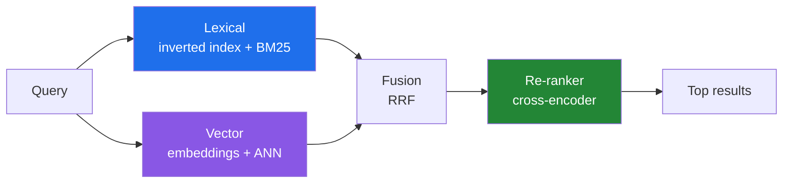

# Search Internals: Inverted Index, BM25 and Vector Search

Search is two problems: **finding** candidate documents quickly and **ranking** them well. For 25 years the answer was the inverted index with BM25 scoring. Embeddings added vector search. Today the best systems use **both**. This post explains how each works, and why hybrid search with re-ranking is the default for RAG (our May post covered RAG itself).

---

## The Pipeline



---

## 1. Analysis: Turning Text into Terms

Before indexing, text goes through an **analyzer**:

```text
"The Runners were RUNNING!"
  → tokenize   → [The, Runners, were, RUNNING]
  → lowercase  → [the, runners, were, running]
  → stop words → [runners, running]
  → stemming   → [runner, run]
```

The query goes through the **same** analyzer, otherwise "Running" would never match "run". Most "why doesn't this match?" bugs are analyzer mismatches. Other tools at this stage: synonyms, n-grams (for partial matching), language-specific stemmers.

---

## 2. The Inverted Index

Like the index at the back of a book: **term → list of documents** (a *posting list*), often with positions for phrase queries.

| Term | Postings (docId: positions) |
|---|---|
| `kafka` | 1:[4], 7:[1, 19], 12:[3] |
| `outbox` | 7:[2], 9:[5] |
| `pattern` | 1:[8], 7:[3], 9:[6] |

- A query for `outbox pattern` **intersects** two short lists. It never scans documents.
- Posting lists are sorted and compressed (delta + variable-byte encoding), so they are very small on disk.
- **Lucene** writes immutable **segments** and merges them in the background, which is the same idea as the LSM tree in our December storage-engines post. That's why new documents become visible after a *refresh* (≈1 s by default in Elasticsearch).

**Used by:** [Lucene](https://lucene.apache.org/) → Elasticsearch, OpenSearch, Solr. Also PostgreSQL full-text search (GIN index on `tsvector`) and Tantivy (Rust).

---

## 3. BM25: Ranking the Matches

[BM25](https://www.staff.city.ac.uk/~sbrp622/papers/foundations_bm25_review.pdf) has been Lucene's default similarity since Elasticsearch 5. Per query term it combines:

| Factor | Intuition |
|---|---|
| **Term frequency (TF)** with saturation (`k1`, ~1.2) | More occurrences help, with diminishing returns |
| **Inverse document frequency (IDF)** | Rare terms ("debezium") matter more than common ones ("data") |
| **Length normalization** (`b`, ~0.75) | A match in a short title counts more than one in a 50-page document |

**Strengths:** exact terms, IDs, error codes, product names, no training needed, explainable (`_explain` API).
**Weakness:** no understanding of meaning. "car" doesn't match "automobile" unless you add synonyms.

---

## 4. Vector Search: Ranking by Meaning

An **embedding model** maps text to a vector, e.g. 768 or 1,024 dimensions. Similar meanings end up close together (measured with cosine or dot product). Search means "find the nearest vectors to the query vector."

Exact nearest-neighbour search across millions of vectors is too slow, so systems use **approximate** nearest neighbour (ANN) indexes:

| Index | How | Trade-off |
|---|---|---|
| **HNSW** ([Malkov & Yashunin](https://arxiv.org/abs/1603.09320)) | Multi-layer graph: coarse long links at the top, fine links at the bottom, greedy search downwards | Fast and high recall; memory-heavy; slow to build |
| **IVF** | Cluster the vectors, search only the nearest clusters | Less memory; recall depends on how many clusters you probe |
| **PQ / quantization** | Compress vectors (int8, binary, product quantization) | 4–32× smaller; small recall loss |
| **DiskANN** | Graph index designed for SSDs | Billion-scale on a single node |

Key parameters: HNSW's `M` and `ef_construction` (build quality) and `ef_search` / `num_candidates` (query-time recall vs latency).

**Used by:** Lucene/Elasticsearch/OpenSearch (HNSW), [pgvector](https://github.com/pgvector/pgvector) (HNSW, IVFFlat), Vespa, Qdrant, Weaviate, Milvus, and FAISS as a library.

**Weakness:** bad at exact tokens. Searching `ERR-4012` or a SKU often returns things that are "semantically similar" but wrong.

---

## 5. Hybrid Search and Re-Ranking

Lexical and vector search fail in different ways, so combine them:

**Reciprocal Rank Fusion (RRF)** merges ranked lists without needing comparable scores:

```text
score(doc) = Σ  1 / (k + rank_in_list)      (k ≈ 60)
```

A document that ranks well in **both** lists wins. RRF is built into Elasticsearch, OpenSearch, and most vector databases.

**Re-ranking:** take the top 50–100 fused candidates and score each query–document pair with a **cross-encoder** model. That's much more accurate than comparing embeddings, but too expensive to run on the whole corpus, so it runs only on the shortlist.

| Stage | Cost per doc | Runs on |
|---|---|---|
| BM25 + ANN retrieval | Microseconds | Millions of docs |
| RRF fusion | Negligible | Hundreds |
| Cross-encoder re-rank | Milliseconds | Top 50–100 |

---

## Practical Tips

- **Start with BM25.** It's a strong baseline. Add vectors when you have measurable recall gaps (our December evals post covers how to measure them).
- **Filters + ANN** are hard to combine: filtering after the vector search can return too few results. Use engines that support filtered HNSW.
- **Chunking** decides retrieval quality in RAG more than the choice of index.
- **Embedding model changes** mean re-indexing everything, so store the model name and version with the index.
- **Measure recall@k and nDCG** on a labelled query set before and after every change.

---

## References

- Robertson & Zaragoza, [The Probabilistic Relevance Framework: BM25 and Beyond](https://www.staff.city.ac.uk/~sbrp622/papers/foundations_bm25_review.pdf), 2009
- Malkov & Yashunin, [Efficient and robust approximate nearest neighbor search using HNSW graphs](https://arxiv.org/abs/1603.09320)
- Cormack, Clarke & Büttcher, [Reciprocal Rank Fusion outperforms Condorcet and individual rank learning methods](https://plg.uwaterloo.ca/~gvcormac/cormacksigir09-rrf.pdf), SIGIR 2009
- Manning, Raghavan & Schütze, [Introduction to Information Retrieval](https://nlp.stanford.edu/IR-book/) (free online)
- [Apache Lucene](https://lucene.apache.org/) · [Elasticsearch — kNN search](https://www.elastic.co/docs/solutions/search/vector/knn) · [Elasticsearch — RRF](https://www.elastic.co/docs/reference/elasticsearch/rest-apis/reciprocal-rank-fusion)
- [pgvector](https://github.com/pgvector/pgvector) · [FAISS](https://github.com/facebookresearch/faiss)
