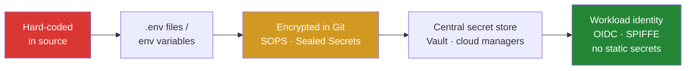
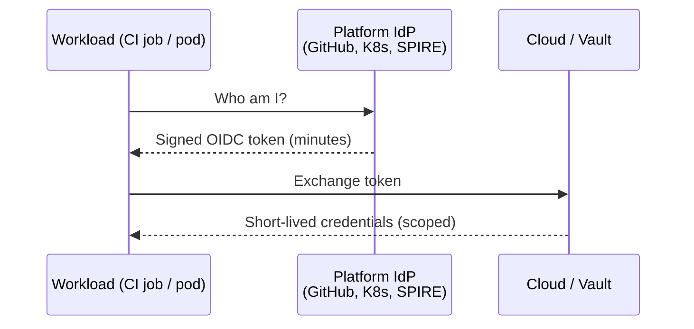

# Secrets Management: From .env to Workload Identity

Every system has secrets: database passwords, API keys, TLS keys, signing keys. Most teams move through the same stages, and each stage fixes the problem the previous one created. The goal at the end is to have **no long-lived secrets at all**.

---

## The Maturity Ladder



| Stage | Fixes | Still broken |
|---|---|---|
| Hard-coded | Nothing | Leaks with every clone, fork and screenshot |
| `.env` / env vars | Secrets leave the source code | Copied around by hand, visible in `/proc`, crash dumps, `docker inspect` |
| Encrypted in Git | GitOps-friendly, reviewable | Rotation is still manual, and the decryption key is a new secret |
| Central store | Audit, access policy, rotation, dynamic credentials | The app still needs a token to reach the store |
| Workload identity | Platform-issued short-lived credentials | Needs IdP/cloud support for each target |

---

## 1. `.env` Files — Fine Locally, Not Beyond

- Keep `.env` in `.gitignore` and commit an `.env.example` without values.
- Environment variables are **not secret storage**. Child processes inherit them, and logs, debug endpoints and error reporters often dump them.
- Kubernetes `Secret` objects are **base64-encoded, not encrypted**. Turn on [encryption at rest](https://kubernetes.io/docs/tasks/administer-cluster/encrypt-data/) (ideally with a KMS provider) and restrict access with RBAC.

---

## 2. Encrypted in Git

The ciphertext lives next to the code, so changes are reviewed in PRs.

| Tool | How | Fit |
|---|---|---|
| **[SOPS](https://github.com/getsops/sops)** (CNCF) | Encrypts only the *values* in YAML/JSON/ENV files with KMS, age or PGP. Diffs stay readable | Any GitOps setup (Flux and Argo CD integrate) |
| **[Sealed Secrets](https://github.com/bitnami-labs/sealed-secrets)** | `kubeseal` encrypts with the cluster's public key, and only the in-cluster controller can decrypt | Kubernetes-only |
| **git-crypt** | Encrypts whole files transparently | Small teams. Coarse-grained, and access is hard to revoke |

```yaml
# SOPS: keys stay readable, values are encrypted
db:
  user: app
  password: ENC[AES256_GCM,data:Tr7o...,iv:...,tag:...,type:str]
sops:
  kms:
    - arn: arn:aws:kms:eu-west-1:111122223333:key/...
```

This is envelope encryption (covered in our June post) in practice: a data key encrypts the file, and KMS encrypts the data key.

---

## 3. Central Secret Stores

| Store | Notable features |
|---|---|
| **[HashiCorp Vault](https://developer.hashicorp.com/vault/docs) / [OpenBao](https://openbao.org/)** | Dynamic secrets, leases, PKI, transit encryption-as-a-service, many auth methods |
| **AWS Secrets Manager / Parameter Store** | Managed rotation (e.g. RDS), IAM policies |
| **Azure Key Vault** | Secrets, keys and certificates; HSM-backed tiers |
| **GCP Secret Manager** | Versioned secrets, IAM, CMEK |

**Dynamic secrets** are the big improvement. Instead of one shared database password, Vault creates a **new user per application instance with a TTL** and drops it when the lease expires. A leaked credential stops working within minutes.

### Getting secrets into Kubernetes

- **[External Secrets Operator](https://external-secrets.io/)** syncs entries from Vault or cloud stores into native `Secret` objects.
- **[Secrets Store CSI Driver](https://secrets-store-csi-driver.sigs.k8s.io/)** mounts secrets as files, without needing a `Secret` object.
- **Vault Agent injector** is a sidecar that renders secrets into a shared volume and renews them.

In Spring, **Spring Cloud Vault** and the cloud-specific config starters load secrets into the `Environment` at startup.

---

## 4. Workload Identity: No Secret to Steal

The final step removes the *bootstrap secret*. The platform already knows who the workload is, so it vouches for it with a short-lived signed token, and the target exchanges that token for credentials.



| Where | Mechanism |
|---|---|
| **GitHub Actions → cloud** | [OIDC federation](https://docs.github.com/en/actions/security-for-github-actions/security-hardening-your-deployments/about-security-hardening-with-openid-connect): trust `repo:org/app:ref:refs/heads/main`. No cloud keys stored in GitHub |
| **Kubernetes → AWS/GCP/Azure** | EKS Pod Identity / IRSA, GKE Workload Identity, Azure Workload Identity, all based on ServiceAccount tokens |
| **Service ↔ service** | [SPIFFE/SPIRE](https://spiffe.io/) issues X.509 or JWT SVIDs for mTLS. Many service meshes use SPIFFE IDs |
| **App → Vault** | Vault Kubernetes, JWT/OIDC or cloud IAM auth methods |

```yaml
# GitHub Actions: deploy to AWS without a stored access key
permissions:
  id-token: write
  contents: read
steps:
  - uses: aws-actions/configure-aws-credentials@v4
    with:
      role-to-assume: arn:aws:iam::111122223333:role/deploy
      aws-region: eu-west-1
```

---

## Detection and Response

Assume something will leak.

- **Prevent:** pre-commit scanning with [gitleaks](https://github.com/gitleaks/gitleaks) or [TruffleHog](https://github.com/trufflesecurity/trufflehog), plus [GitHub push protection](https://docs.github.com/en/code-security/secret-scanning/introduction/about-push-protection).
- **Detect:** secret scanning on the repo and its history. Provider partner programs revoke some leaked tokens automatically.
- **Respond:** **rotate first, then clean up.** Removing the commit doesn't help, because the secret is already in forks, caches and CI logs.
- **Design for rotation:** support two valid credentials at a time (old and new) so you can rotate without downtime.

---

## Checklist

- [ ] No secrets in source, images, or CI variables that could use OIDC instead
- [ ] Kubernetes Secrets encrypted at rest; RBAC restricts `get secrets`
- [ ] A single source of truth (store or SOPS), not copies on laptops
- [ ] Short TTLs, with dynamic credentials where possible
- [ ] Every access is audited, and every secret has an owner and a rotation date
- [ ] Secret scanning runs before the push, not only after
- [ ] Leaks are handled by rotating, not by deleting the commit

---

## References

- [OWASP Secrets Management Cheat Sheet](https://cheatsheetseries.owasp.org/cheatsheets/Secrets_Management_Cheat_Sheet.html)
- [Kubernetes — Good practices for Secrets](https://kubernetes.io/docs/concepts/security/secrets-good-practices/) · [Encrypting data at rest](https://kubernetes.io/docs/tasks/administer-cluster/encrypt-data/)
- [HashiCorp Vault docs](https://developer.hashicorp.com/vault/docs) · [OpenBao](https://openbao.org/)
- [SOPS](https://github.com/getsops/sops) · [Sealed Secrets](https://github.com/bitnami-labs/sealed-secrets) · [External Secrets Operator](https://external-secrets.io/) · [Secrets Store CSI Driver](https://secrets-store-csi-driver.sigs.k8s.io/)
- [GitHub Actions — OpenID Connect](https://docs.github.com/en/actions/security-for-github-actions/security-hardening-your-deployments/about-security-hardening-with-openid-connect)
- [SPIFFE / SPIRE](https://spiffe.io/)
- [Spring Cloud Vault](https://spring.io/projects/spring-cloud-vault)
