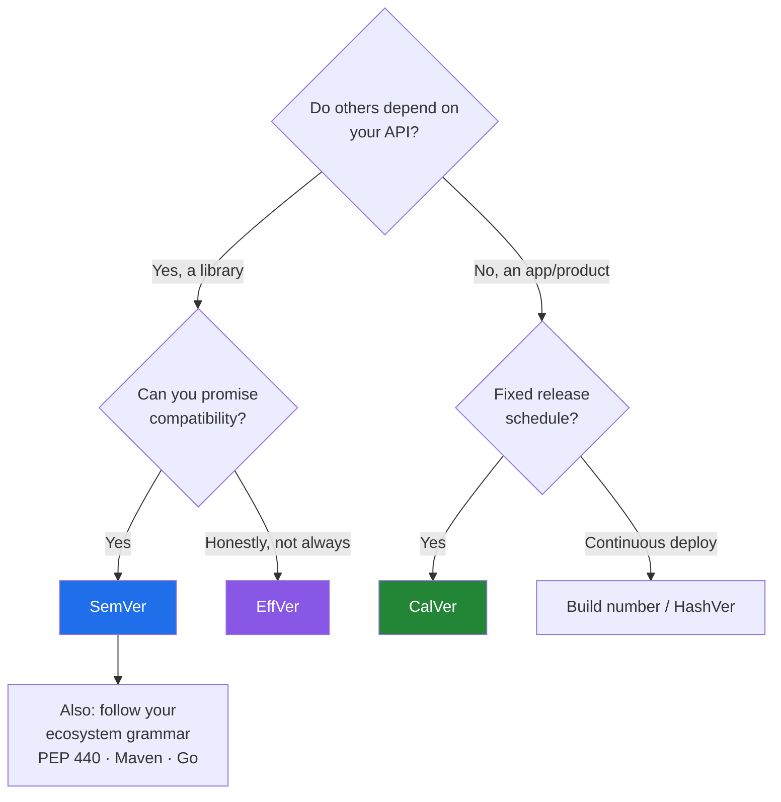

# Software Versioning: From SemVer to π

A version number is a tiny API. It tells users *when* something shipped, *how risky* the upgrade is, or *nothing at all* — depending on the scheme. This post is a quick map: the schemes everyone uses, the ones only certain ecosystems use, and the niche ones worth knowing.

---

## The 30-Second Model

Every scheme answers one of three questions:

| Question | Scheme family | Example |
|---|---|---|
| **Will this break me?** | Semantic (compatibility-based) | `2.4.1` → `3.0.0` |
| **When was this released?** | Calendar (time-based) | `24.04`, `2026.1` |
| **Which build is this?** | Sequential / identity | `130.0.6723.58`, `a1b2c3d` |

Most real products mix them — e.g. Java is time-based in cadence but semantic in shape.

---

## 1. Widely Used

### Semantic Versioning (SemVer) — `MAJOR.MINOR.PATCH`

The default for libraries. Spec: [semver.org](https://semver.org/).

- **MAJOR** — breaking change · **MINOR** — new, backward-compatible feature · **PATCH** — bug fix
- Pre-release and build metadata: `1.0.0-alpha.1`, `1.0.0-rc.1+build.42`
- Precedence: `1.0.0-alpha < 1.0.0-alpha.1 < 1.0.0-beta < 1.0.0-rc.1 < 1.0.0`
- `0.y.z` means "anything may change"

**Used by:** npm, Cargo (Rust), Kubernetes, Terraform, Spring Boot, most GitHub libraries.

Package managers build on it with ranges:

```text
^1.4.2   →  >=1.4.2 <2.0.0   (npm/Cargo default: accept minor + patch)
~1.4.2   →  >=1.4.2 <1.5.0   (accept patch only)
```

**Catch:** SemVer is a *promise*, not a guarantee. Someone decides what "breaking" means, and every bug fix breaks somebody who relied on the bug.

### Calendar Versioning (CalVer) — `YY.MM`, `YYYY.N`, …

The version is the release date (or date + counter). Spec: [calver.org](https://calver.org/).

| Product | Format | Example |
|---|---|---|
| Ubuntu | `YY.MM` | `24.04` (April 2024, LTS) |
| pip | `YY.N` | `24.2` |
| Black | `YY.MM.N` | `24.10.0` |
| JetBrains IDEs, Unity | `YYYY.N` | `2026.1` |
| Spring Cloud release train | `YYYY.MINOR.MICRO` | `2025.0.0` (since 2020.0, previously London tube station names) |
| yt-dlp | `YYYY.MM.DD` | `2026.10.01` |
| Windows 10/11 feature updates | `YYH1/H2` | `24H2` |
| Apple OSes (since 2025) | year-based | iOS 26, macOS 26 Tahoe |

**Best for:** products on a fixed release schedule, apps (not libraries), and things where "how old is this?" matters more than API compatibility.

**Catch:** says nothing about breakage. Python considered CalVer in [PEP 2026](https://peps.python.org/pep-2026/) and rejected it.

### Time-boxed semantic — the hybrid most platforms use

Fixed cadence, SemVer-shaped numbers:

- **Java** ([JEP 322](https://openjdk.org/jeps/322)): `FEATURE.INTERIM.UPDATE.PATCH` — a new feature release every 6 months (`25`, `26`…), LTS every two years (17, 21, 25).
- **Node.js**: a major every 6 months; **even** majors become LTS, **odd** ones are short-lived.
- **Kubernetes**: ~3 minor releases a year, each supported ~14 months, with a strict version-skew policy.
- **Chrome**: `MAJOR.MINOR.BUILD.PATCH` (`130.0.6723.58`), new major every 4 weeks — the major is effectively a counter.
- **Firefox**: rapid release since v5 (2011) plus an **ESR** (Extended Support Release) line for enterprises.

---

## 2. Less Widely Used (but standard in their ecosystem)

### Ecosystem-specific grammars

Each packaging system has its own ordering rules, and they *differ*.

| Ecosystem | Format | Notable quirk |
|---|---|---|
| **Python** — [PEP 440](https://peps.python.org/pep-0440/) | `[N!]X.Y[.Z][aN\|bN\|rcN][.postN][.devN][+local]` | Epoch `1!2.0` resets ordering; `.post1` for packaging-only fixes; `+ubuntu1` local labels |
| **Debian / Ubuntu** — [Debian Policy](https://www.debian.org/doc/debian-policy/ch-controlfields.html#version) | `[epoch:]upstream[-revision]` | `~` sorts before everything, even the end of the string: `1.0~rc1 < 1.0` |
| **RPM** (Fedora, RHEL) | `[epoch:]version-release` | `2.4.6-1.el9` — release counts the distro's rebuilds |
| **Maven** | `X.Y.Z[-qualifier]` | `-SNAPSHOT` = mutable dev build; qualifiers ordered `alpha < beta < milestone < rc < snapshot < (release) < sp` |
| **Go modules** — [go.dev/ref/mod](https://go.dev/ref/mod#versions) | `vX.Y.Z` | v2+ changes the **import path** (`example.com/lib/v2`); untagged commits get pseudo-versions `v0.0.0-20191109021931-daa7c04131f5` |
| **Haskell** — [PVP](https://pvp.haskell.org/) | `A.B.C.D` | **A.B together** is the major version |

**Lesson:** "is `1.0rc1` newer than `1.0`?" has different answers in different ecosystems. Never compare versions with string sorting — use the ecosystem's own library (`packaging.version`, `dpkg --compare-versions`, `semver`).

### Odd/even stability lines

Odd minor = development, even minor = stable. Used historically by the **Linux kernel** (2.4 stable, 2.5 dev — dropped with 2.6), **GNOME** (until 3.38; since 40 integer majors), and still echoed by **Node.js** LTS.

### Release-train and codename versioning

Names instead of (or alongside) numbers:

- **Debian**: Toy Story characters (bookworm, trixie)
- **Ubuntu**: alliterative animals (Noble Numbat)
- **Android**: desserts until Android 10; now numbers + **API level** (the number developers actually target)
- **Stripe API**: date + codename, e.g. `2025-03-31.basil`

### Date-based API versioning

For web APIs the "version" is the contract date, sent in a header or query string:

| API | How |
|---|---|
| GitHub REST | `X-GitHub-Api-Version: 2022-11-28` |
| Stripe | `Stripe-Version: 2025-03-31.basil` |
| Azure | `?api-version=2024-01-01` |
| Kubernetes | `v1alpha1 → v1beta1 → v1` (stability levels, not dates) |

Clients pin a date; the server keeps old behaviour for them. No URL-wide `/v2` rewrite needed.

### Marketing vs. internal versions

The number on the box is not the number in the code:

| Marketing | Internal |
|---|---|
| Windows 7 | NT 6.1 |
| Java 5 | `1.5.0` |
| macOS 11 Big Sur | reports `10.16` to old apps for compatibility |
| Windows 11 24H2 | build `26100` |

### Language-standard years

Specs use the publication year: **ECMAScript** (`ES2015`…`ES2025`), **C++** (`C++20`, `C++23`), **Rust editions** (`2015`/`2018`/`2021`/`2024`) — editions sit *on top of* SemVer'd compilers and let the language evolve without breaking old crates.

---

## 3. Niche and Very Little Known

| Scheme | Idea | Who uses it |
|---|---|---|
| **TeX → π, Metafont → e** | Each fix adds a digit: TeX `3.141592653`, Metafont `2.7182818`. Knuth: at his death the versions become exactly π and e, and remaining bugs become features. | TeX, Metafont |
| **[EffVer](https://jacobtomlinson.dev/effver/)** | `MACRO.MESO.MICRO` = *expected upgrade effort* (large / some / none), not a compatibility promise. An honest SemVer. | JAX (since 0.5.0, [JEP 25516](https://docs.jax.dev/en/latest/jep/25516-effver.html)) |
| **[ZeroVer](https://0ver.org/)** (satire) | Never leave `0.x`, so you never promise stability. | Real effect: Terraform stayed 0.x until 2021; many tools (Neovim, Hugo) still 0.x |
| **Romantic versioning** | Jeremy Ashkenas: numbers reflect *how big it feels*, not strict compatibility. | CoffeeScript, Backbone, Underscore |
| **[HashVer](https://miniscruff.github.io/hashver/)** | `YYYY.MM[.DD].<commit-hash>` — generated automatically on deploy. | Continuously deployed apps, nightlies |
| **`git describe`** | `v2.3.1-14-g3f2a9c1` = 14 commits after tag `v2.3.1`, at commit `3f2a9c1`. | Git itself, setuptools-scm, many CI builds |
| **DNS SOA serial** | `YYYYMMDDnn` in a zone file; must only increase or secondaries ignore the update. | Every hand-edited DNS zone ([RFC 1912](https://www.rfc-editor.org/rfc/rfc1912)) |
| **Migration versions** | `V1__init.sql`, `V2_1__add_index.sql` — ordered, applied once, never edited. | Flyway, Liquibase changesets |
| **Monotonic build numbers** | Single increasing integer. | Windows (`26100`), macOS (`24A335`), Android `versionCode` |
| **[Pride Versioning](https://pridever.org/)** (satire) | `PROUD.DEFAULT.SHAME` — bump SHAME for fixes too embarrassing to admit. | Jokes, mostly |
| **Elm enforced SemVer** | The package manager *diffs the API* and decides the bump for you (`elm diff`, `elm bump`). | Elm packages |

Elm deserves a highlight: it is the only mainstream registry where SemVer is **verified by the tool** rather than trusted to the author.

---

## Choosing a Scheme



- **Library** → SemVer (or EffVer if you're being honest about grey areas).
- **Application / OS / platform** → CalVer or time-boxed semantic.
- **Web API** → date-based header versioning.
- **Internal services deployed many times a day** → build number or commit hash; nobody reads it except your logs.
- **Always** → respect your ecosystem's grammar and never sort versions as strings.

---

## Automation

Don't bump by hand:

- **[Conventional Commits](https://www.conventionalcommits.org/)** (`feat:`, `fix:`, `feat!:`) + **semantic-release** or **release-please** → computes the SemVer bump from commit messages.
- **Changesets** — monorepos, per-package bumps.
- **setuptools-scm**, **GitVersion**, **Nerdbank.GitVersioning** — version derived from git tags.
- **bump-my-version** — rewrites the number across files in one command.

---

## References

- [Semantic Versioning 2.0.0](https://semver.org/) · [Calendar Versioning](https://calver.org/)
- [PEP 440 — Python version identification](https://peps.python.org/pep-0440/) · [PEP 2026 (rejected CalVer for Python)](https://peps.python.org/pep-2026/)
- [Debian Policy — Version field](https://www.debian.org/doc/debian-policy/ch-controlfields.html#version)
- [Go Modules Reference — Versions](https://go.dev/ref/mod#versions)
- [Maven — Version order specification](https://maven.apache.org/pom.html#version-order-specification)
- [Haskell Package Versioning Policy](https://pvp.haskell.org/)
- [JEP 322 — Time-Based Release Versioning](https://openjdk.org/jeps/322) · [Node.js Releases](https://nodejs.org/en/about/previous-releases) · [Kubernetes Version Skew Policy](https://kubernetes.io/releases/version-skew-policy/)
- [Spring Cloud — Updates to Spring Versions (2020)](https://spring.io/blog/2020/04/30/updates-to-spring-versions)
- [GitHub REST API versions](https://docs.github.com/en/rest/about-the-rest-api/api-versions) · [Stripe API versioning](https://docs.stripe.com/api/versioning)
- [EffVer](https://jacobtomlinson.dev/effver/) · [ZeroVer](https://0ver.org/) · [HashVer](https://miniscruff.github.io/hashver/) · [Pride Versioning](https://pridever.org/)
- [Andrew Nesbitt — From ZeroVer to SemVer: a list of versioning schemes in open source](https://nesbitt.io/2024/06/24/from-zerover-to-semver-a-comprehensive-list-of-versioning-schemes-in-open-source.html)
- [Conventional Commits](https://www.conventionalcommits.org/)
