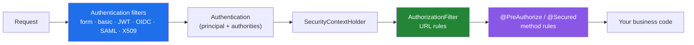

# Spring Security: Every Way In, Every Rule

Spring Security ships more ways to prove an identity than most teams ever discover: form login, HTTP Basic, HTTP Digest, LDAP, OAuth 2.0 / OIDC, SAML 2.0, CAS, X.509 client certificates, Kerberos/SPNEGO, container pre-authentication, JAAS, passkeys, one-time tokens, and multi-factor combinations of all of them. The authorization side is just as wide — URL rules, SpEL method annotations, `@Secured`/`@RolesAllowed`, role hierarchies, per-object ACLs, and factor-aware "prove it again" rules.

This post is the map: **every mechanism Spring Security supports, what it costs, where it fits, and how the types compare.** Examples are Java 21 with Spring Security 6/7 syntax and stay deliberately short. Our earlier July deep-dive covers the filter-chain architecture this all sits on — here we care about the menu, not the plumbing.

---

## The 40-Second Model



Authentication filters *populate* an `Authentication` object; the `SecurityContextHolder` carries it on the thread; authorization reads it. That separation is the whole trick — swapping form login for a JWT resource server touches only the left half. The right half (URL rules, `@PreAuthorize`) doesn't care how the user got here, which is why the two halves can be mixed freely in one application.

---

## Authentication: The Complete Menu

### 1. Username and password — Form, Basic, Digest, LDAP

All four read a username/password and hand it to an `AuthenticationManager`; the difference is only *how the client presents it* and *where the user record lives*.

```java
http
    .formLogin(Customizer.withDefaults())     // session + login page, redirects
    .httpBasic(Customizer.withDefaults())     // Authorization: Basic header per request
    .httpDigest(Customizer.withDefaults())    // challenge/response, legacy only
    .ldapAuthentication(ldap -> ldap           // bind or password-compare against a directory
        .userDnPatterns("uid={0},ou=people")
        .contextSource().url("ldap://localhost:8389/dc=example,dc=com"));
```

- **Form login** creates an `HttpSession`, stores the context in the session cookie, and redirects unauthenticated users to a generated or custom `/login` page. The default for server-rendered apps.
- **HTTP Basic** sends credentials on *every* request, so it is stateless — but base64 is not encryption. Only over TLS, mostly for internal services and CLI clients.
- **HTTP Digest** avoids sending the plaintext password but requires storing `MD5(username:realm:password)` — no salt, no adaptive hashing. It exists for legacy systems; prefer Basic-over-TLS or tokens.
- **LDAP** keeps credentials in your directory: `bind` authenticates as the user (password never leaves the server), password-compare fetches the hash and checks locally. Backed by Spring LDAP.

Form, Basic and Digest all validate through `DaoAuthenticationProvider` + `UserDetailsService` + `PasswordEncoder`, so switching between them is a one-line config change — the user store stays identical.

### 2. Federated SSO — OAuth 2.0 / OIDC, SAML 2.0, CAS

When the identity provider is somebody else (Google, Keycloak, Okta, an enterprise IdP), you don't handle passwords at all:

```java
http
    .oauth2Login(Customizer.withDefaults())   // OIDC or bare OAuth2 (e.g. GitHub)
    .saml2Login(Customizer.withDefaults());   // SAML 2.0 via IdP metadata
```

```yaml
spring:
  security:
    oauth2:
      client:
        registration:
          google: { client-id: ${GOOGLE_CLIENT_ID}, client-secret: ${GOOGLE_CLIENT_SECRET} }
```

- **OAuth2 Login** runs the authorization-code flow. With OIDC you get `id_token`, profile claims and logout; without OIDC (GitHub-style) you get whatever profile endpoint the provider exposes. Your app keeps a *local* session — only the login is delegated.
- **SAML 2.0 Login** is the enterprise-SSO equivalent: metadata exchange, signed assertions, usually behind a corporate IdP that predates OIDC.
- **CAS** validates Central Authentication Service tickets — older campus/intranet SSO.

Same `SecurityFilterChain` slot, same authorization rules afterwards: `hasRole("ADMIN")` works identically whether the role came from a local database or from an `authorities` claim in a Google ID token.

### 3. Phishing-resistant — Passkeys, One-Time Tokens, MFA

```java
// Passkeys (WebAuthn): the credential never leaves the device
http.webAuthn(w -> w.rpName("My App").rpId("example.com")
        .allowedOrigins(Set.of("https://example.com")));

// One-time token: magic link / emailed code
http.oneTimeTokenLogin(Customizer.withDefaults());

// MFA: require BOTH factors on every rule
@EnableMultiFactorAuthentication(authorities = {
        FactorGrantedAuthority.PASSWORD_AUTHORITY,
        FactorGrantedAuthority.OTT_AUTHORITY })
```

- **Passkeys** are WebAuthn credentials (Touch ID, Windows Hello, hardware keys): public-key cryptography, nothing to phish, no shared secret.
- **One-time tokens (OTT)** deliver a short-lived token over email or SMS. Standalone they are passwordless login; combined with a password they become the second factor.
- **MFA** in modern Spring Security is expressed as *authorities*: authenticating with a password grants `FACTOR_PASSWORD`, completing an OTT grants `FACTOR_OTT`, and authorization rules demand combinations via `hasAllAuthorities(...)` or `@EnableMultiFactorAuthentication`. Because it is authorization-driven, you get step-up for free — restrict `/admin/**` to `FACTOR_OTT + ROLE_ADMIN` while everything else accepts a plain login.

### 4. On the wire — X.509, Kerberos/SPNEGO, Pre-authentication, JAAS

These delegate the proof to infrastructure you already run:

| Mechanism | What proves identity | Enable with | Fit |
|---|---|---|---|
| **X.509 client certs** | TLS client certificate (CN → username) | `.x509(Customizer.withDefaults())` | mTLS service-to-service, smart cards |
| **Kerberos / SPNEGO** | Ticket from a KDC, `Authorization: Negotiate` | `spring-security-kerberos` module | Active Directory intranets |
| **Pre-authentication** | Header/principal set by a proxy or container (SiteMinder, Java EE `getUserPrincipal`) | pre-auth filter + `PreAuthenticatedAuthenticationProvider` | Behind an SSO proxy; the app only authorizes |
| **JAAS** | Login context from a JAAS `LoginModule` | `JaasAuthenticationProvider` | Legacy/JEE security realms |

The pattern is always the same: something *in front of* Spring Security establishes who the caller is, and Spring Security takes over from there — authorization, CSRF, headers, session policy. This is the cheapest path to SSO if your org already terminated authentication at the proxy.

### 5. Machine-to-machine — OAuth2 Resource Server (JWT, opaque, DPoP)

For APIs, identity arrives as a bearer token instead of a session:

```java
http.csrf(csrf -> csrf.disable())
    .sessionManagement(sm -> sm.sessionCreationPolicy(SessionCreationPolicy.STATELESS))
    .oauth2ResourceServer(oauth2 -> oauth2.jwt(Customizer.withDefaults()));
```

```yaml
spring.security.oauth2.resourceserver.jwt.issuer-uri: https://your-idp.example.com/
```

- **JWT** — self-contained: signature, expiry and issuer verified locally against the provider's JWK Set. No network call per request, trivially horizontal-scalable.
- **Opaque token** — an opaque handle validated by introspection at the authorization server. Instant revocation, at the cost of a round trip per request.
- **DPoP-bound tokens** — sender-constrained tokens whose proof-of-possession key is bound into the token; a stolen bearer token is useless without the private key. The newest option, and the right answer to token replay.

JWT scopes arrive as `SCOPE_*` authorities, so `hasAuthority("SCOPE_messages:read")` is all you need to gate an endpoint.

### 6. Building your own — publish the `AuthenticationManager`

If the mechanism you want isn't on the menu (JSON login, hardware dongle, home-grown SSO), publish the manager and authenticate in your own controller — Spring Security still owns validation, session/context persistence and every authorization rule:

```java
@PostMapping("/login")
Authentication login(@RequestBody Credentials c) {
    var request = UsernamePasswordAuthenticationToken.unauthenticated(c.user(), c.pass());
    return authenticationManager.authenticate(request);   // you persist the SecurityContext
}
```

### Authentication compared

| Mechanism | Proof carried by | Server state | SSO | Best fit |
|---|---|---|---|---|
| Form login | Session cookie | Session | ✗ (or via IdP) | Server-rendered apps, same-domain SPAs |
| HTTP Basic | Basic header each request | None | ✗ | Internal APIs, CLIs, over TLS only |
| HTTP Digest | Challenge response | None | ✗ | Legacy only — weak hash, no salt |
| LDAP | Bind or hash compare | Session or none | ✗ | Corporate directory as user store |
| OAuth2/OIDC login | Authorization-code flow | Local session | ✓ | "Sign in with Google/Keycloak" |
| SAML 2.0 login | Signed assertion | Local session | ✓ | Enterprise IdP, pre-OIDC SSO |
| CAS | Ticket | Session | ✓ | Older campus/intranet SSO |
| Resource server (JWT) | Bearer JWT | None | ✓ (shared IdP) | Microservices, mobile backends |
| Resource server (opaque) | Opaque token | None | ✓ | When revocation must be instant |
| DPoP token | Bound token + key | None | ✓ | High-value APIs, replay resistance |
| X.509 | Client certificate | Session or none | ✗ | mTLS, smart cards |
| Kerberos/SPNEGO | Kerberos ticket | Session | ✓ (realm) | Active Directory environments |
| Pre-auth | Proxy-set header/principal | Session | ✓ | SSO terminated at the proxy |
| JAAS | LoginModule result | Session | ✗ | Legacy JEE realms |
| Passkeys | Device-held key pair | Session | ✗ | Passwordless, phishing-proof login |
| One-time token | Email/SMS token | Session | ✗ | Passwordless or second factor |
| MFA (composed) | 2+ factor authorities | Session | — | Step-up for sensitive operations |

---

## Authorization: The Complete Menu

### 1. URL rules — `authorizeHttpRequests`

The coarse gate, evaluated in the filter chain before your controller runs:

```java
.authorizeHttpRequests(auth -> auth
    .requestMatchers("/", "/public/**").permitAll()
    .requestMatchers("/admin/**").hasRole("ADMIN")
    .requestMatchers("/api/**").hasAuthority("SCOPE_messages:read")
    .requestMatchers("/internal/**").hasIpAddress("10.0.0.0/8")
    .anyRequest().authenticated())
```

Available rules: `permitAll`, `denyAll`, `authenticated`, `anonymous`, `hasRole` / `hasAnyRole`, `hasAuthority` / `hasAnyAuthority`, `hasAllAuthorities`, `hasIpAddress`, and `access(manager)` for anything custom:

```java
.requestMatchers("/reports/**").access((auth, ctx) ->
        new AuthorizationDecision(auth != null && auth.get().getName().startsWith("team-")))
```

Rules are **first-match-wins**, top to bottom — `.anyRequest()` must be last. This DSL is backed by an `AuthorizationManager`, the same extension point used everywhere else.

### 2. Method security — the rule lives next to the code

```java
@EnableMethodSecurity(securedEnabled = true, jsr250Enabled = true)
class MethodSecurityConfig {}

@Service
class AccountService {

    @PreAuthorize("hasRole('ADMIN')")                         // before: cheap, fails fast
    void close(long id) { ... }

    @PostAuthorize("returnObject.owner == authentication.name")  // after: needs the data first
    Account read(long id) { ... }

    @PreFilter("filterObject.owner == authentication.name")     // drop items from a parameter
    void updateAll(List<Account> accounts) { ... }

    @PostFilter("filterObject.owner == authentication.name")    // drop items from the result
    List<Account> listMine() { ... }

    @Secured("ROLE_AUDIT")                                     // plain roles, no SpEL
    void audit(...) { ... }

    @RolesAllowed("ROLE_ADMIN")                                // JSR-250, same idea
    void purge(...) { ... }
}
```

Six annotations, two switches: `@PreAuthorize`/`@PostAuthorize`/`@PreFilter`/`@PostFilter` are on by default (`prePostEnabled`), while `@Secured` and `@RolesAllowed` are **silently ignored** unless you enable them explicitly. SpEL gives you `#id`, `#root`, `returnObject`, `authentication` and method names — expression language evaluated before/after the proxy around your bean.

### 3. Role hierarchy — stop repeating expressions

```java
@Bean
static RoleHierarchy roleHierarchy() {
    return RoleHierarchyImpl.fromHierarchy("ROLE_ADMIN > ROLE_SUPERVISOR > ROLE_USER");
}
```

Now `hasRole("USER")` passes for supervisors and admins, without `hasAnyRole("ADMIN","SUPERVISOR","USER")` at every rule. Configure the hierarchy once and every `authorizeHttpRequests` rule and every `@PreAuthorize` expression inherits it.

### 4. Per-object rules — domain object ACLs

When the question is not "may this user reach `/accounts/42`" but "may *this* user touch *this* record", Spring Security ships ACL support backed by its own tables and `MutableAclService`:

```java
@PreAuthorize("hasPermission(#id, 'Account', 'read')")
Account read(long id);
```

Ownership, permissions and inheritance are stored per object in the database, so rules outlive the session. It is by far the heaviest option — schema, caching layer, a service call per check. Reach for it only when authorization genuinely lives at the record level across many entry points; for a single service, `@PostAuthorize("returnObject.owner == authentication.name")` does the same job with zero infrastructure.

### 5. Factor-aware rules — MFA and step-up re-authentication

Because factors are authorities, the authorization layer composes them:

```java
.authorizeHttpRequests(auth -> auth
    .requestMatchers("/admin/**").hasAllAuthorities(
            FactorGrantedAuthority.PASSWORD_AUTHORITY,
            FactorGrantedAuthority.OTT_AUTHORITY,
            "ROLE_ADMIN")
    .anyRequest().authenticated())
```

`@EnableMultiFactorAuthentication` applies that combination to *every* rule, `AuthorizationManagerFactories.multiFactor()` scopes it to selected rules, and `.validDuration(Duration.ofMinutes(30))` adds "authenticated within the last 30 minutes" — re-authentication expressed as an authorization rule rather than hand-rolled session bookkeeping.

### 6. Reactive stacks — same model, different proxies

WebFlux applications get `@EnableReactiveMethodSecurity` and a reactive `authorizeHttpRequests` DSL. The annotations and the `AuthorizationManager` abstraction are shared; only the filter chain and the proxying differ. If you know the servlet side, the reactive side is a translation, not a new system.

### Authorization compared

| Tool | Granularity | Runs | Cost | Use it when |
|---|---|---|---|---|
| `authorizeHttpRequests` | URL pattern | Filter chain, before controller | Cheapest | Public/private, coarse roles, IP allow-lists |
| `@PreAuthorize` | Method (input) | AOP proxy on the bean | Low | Business rules belong with the code that enforces them |
| `@PostAuthorize` | Method (result) | After execution | Low | Ownership only knowable after loading data |
| `@PreFilter` / `@PostFilter` | Collection elements | Around the call | Low | Strip unauthorized items in/out |
| `@Secured` / `@RolesAllowed` | Method (roles) | AOP proxy | Low | Legacy/standards-based role checks — must be enabled |
| Role hierarchy | Roles, transitively | Inside every check | Negligible | Admin > supervisor > user ladders |
| ACLs | Individual object | DB-backed lookup per check | Heaviest | Per-record permissions shared across applications |
| `access(...)` custom manager | Anything you can express | Filter or method | Yours | MFA, time windows, IP + role combos |
| Reactive method security | Method | WebFlux proxy | Low | WebFlux apps — same annotations |

URL rules and method rules are **independent and additive**: a request must clear `authorizeHttpRequests` to reach the controller, then the service annotation applies a second, finer check. A clean default is a permissive-looking URL gate (`anyRequest().authenticated()`) with the real business rules expressed as `@PreAuthorize` on services.

---

## Choosing a Combination

- **Server-rendered app** — form login + session, URL rules for public/admin, `@PreAuthorize` on services, CSRF on.
- **Stateless REST API** — JWT resource server (opaque if you need instant revocation), `SessionCreationPolicy.STATELESS`, CSRF off, `SCOPE_*` authorities.
- **"Sign in with…" for a web app** — `oauth2Login()` with your IdP; keep a local session and let the authorization half run as usual.
- **Enterprise SSO** — SAML 2.0 if the IdP demands it, OIDC otherwise; API traffic still goes through the resource server.
- **High assurance / admin surfaces** — passkeys or password + OTT, with factor-aware rules on the sensitive paths only.
- **Org-wide authentication at the proxy** — pre-authentication (or X.509/Kerberos if that's what the network speaks); Spring Security does authorization only.
- **Record-level ownership in one service** — `@PostAuthorize`/`@PostFilter`. Only add ACLs when ownership must be queried as data by several applications.

---

## Gotchas Worth Memorizing

**Stacking mechanisms on one chain is not "more secure".** `formLogin()` + `httpBasic()` + `oauth2ResourceServer()` on the *same* chain means any one of them authenticates the request — an attacker picks the weakest door. Each mechanism should live on its own `SecurityFilterChain`, selected by `securityMatcher("/api/**")` versus the session chain.

**`@Secured` and `@RolesAllowed` are off by default.** The annotation compiles, the bean runs — and the check never happens. Always set `@EnableMethodSecurity(securedEnabled = true, jsr250Enabled = true)` if you use them, and prefer `@PreAuthorize` for anything new.

**Method security only protects Spring beans, and self-invocation bypasses it.** `this.close(id)` from inside the same class skips the proxy entirely — the single most common way a `@PreAuthorize` disappears in production.

**Digest authentication fights your password storage.** It needs an unsalted MD5 of `username:realm:password` instead of a `BCrypt`/`Argon2` hash, so it forces a second, weaker credential format. Treat any use of it as a migration candidate, not a choice.

---

**References**

- [Spring Security — Project Page](https://spring.io/projects/spring-security)
- [Authentication Mechanisms (Servlet)](https://docs.spring.io/spring-security/reference/servlet/authentication/index.html)
- [Username/Password — Form, Basic, Digest, LDAP](https://docs.spring.io/spring-security/reference/servlet/authentication/passwords/index.html)
- [OAuth 2.0 Login](https://docs.spring.io/spring-security/reference/servlet/oauth2/login/index.html)
- [OAuth2 Resource Server — JWT, Opaque, DPoP](https://docs.spring.io/spring-security/reference/servlet/oauth2/resource-server/index.html)
- [SAML 2.0 Log In](https://docs.spring.io/spring-security/reference/servlet/saml2/login/index.html)
- [Passkeys](https://docs.spring.io/spring-security/reference/servlet/authentication/passkeys.html) · [One-Time Token](https://docs.spring.io/spring-security/reference/servlet/authentication/onetimetoken.html) · [Multi-Factor Authentication](https://docs.spring.io/spring-security/reference/servlet/authentication/mfa.html)
- [Pre-Authentication](https://docs.spring.io/spring-security/reference/servlet/authentication/preauth.html) · [X509](https://docs.spring.io/spring-security/reference/servlet/authentication/x509.html) · [CAS](https://docs.spring.io/spring-security/reference/servlet/authentication/cas.html) · [JAAS](https://docs.spring.io/spring-security/reference/servlet/authentication/jaas.html)
- [Spring Security Kerberos](https://docs.spring.io/spring-security-kerberos/reference/ssk.html)
- [authorizeHttpRequests](https://docs.spring.io/spring-security/reference/servlet/authorization/authorize-http-requests.html)
- [Method Security](https://docs.spring.io/spring-security/reference/servlet/authorization/method-security.html)
- [Domain Object Security (ACLs)](https://docs.spring.io/spring-security/reference/servlet/authorization/acls.html)
- [Reactive Authorization](https://docs.spring.io/spring-security/reference/reactive/authorization/index.html)
