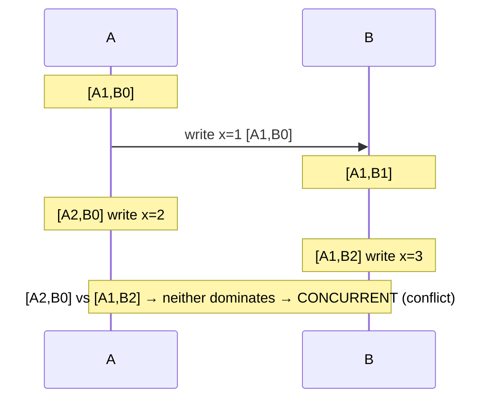

# Time in Distributed Systems: Clocks You Can't Trust

Happy New Year. Midnight is a good moment to ask what time it *actually* is, because in a distributed system there is no single answer. Every machine has its own clock, every clock drifts, and NTP can move it backwards. Yet we use timestamps to order events, expire leases, resolve conflicts and generate IDs.

This post covers what goes wrong and the four kinds of clocks used to deal with it.

---

## Two Clocks on Every Machine

| | Wall clock (time of day) | Monotonic clock |
|---|---|---|
| Java | `System.currentTimeMillis()`, `Instant.now()` | `System.nanoTime()` |
| Linux | `CLOCK_REALTIME` | `CLOCK_MONOTONIC` |
| Can jump backwards? | **Yes** (NTP corrections, manual changes, VM migration) | No |
| Comparable across machines? | Roughly | **No**, it's meaningless outside the process |
| Use for | Timestamps shown to humans, logs | Timeouts, durations, rate limits |

**Rule:** measure durations with the monotonic clock. Cloudflare's [2017 leap-second outage](https://blog.cloudflare.com/how-and-why-the-leap-second-affected-cloudflare-dns/) happened because code computed a duration from wall-clock time and got a **negative number**.

In Java, inject a `java.time.Clock` instead of calling `Instant.now()` directly, so tests can control time.

---

## Why Physical Clocks Disagree

- **Drift**: quartz oscillators drift by roughly tens of ppm, which is milliseconds to seconds per day.
- **NTP** keeps machines within about **milliseconds** over the internet, better within a data centre. It can *step* the clock (jump) or *slew* it (gradually speed up or slow down).
- **PTP (IEEE 1588)** with hardware timestamping reaches **sub-microsecond** accuracy. Used in trading and telecom, and increasingly in cloud time services.
- **Leap seconds**: UTC sometimes inserts a 61st second. Google and the major clouds **smear** it over hours instead. The CGPM voted in 2022 to stop adding leap seconds by 2035.
- **VM pauses and GC pauses**: a process can freeze for seconds and then act on a lease or timestamp that is already stale.

**Consequence: "last write wins" by timestamp can lose data.** If node A's clock runs 50 ms ahead, its older write can overwrite node B's newer one. Cassandra's per-cell LWW timestamps make exactly this trade-off.

---

## Logical Clocks: Order Without Time

Lamport's insight ([1978](https://lamport.azurewebsites.net/pubs/time-clocks.pdf)): often you don't need *when* something happened, only **what happened before what**.

### Lamport clock

A single counter per node. Increment it on every event, send it with every message, and on receive set `counter = max(local, received) + 1`.

- If A happened before B, then `L(A) < L(B)`.
- The reverse **doesn't hold**: `L(A) < L(B)` doesn't mean A caused B. Lamport clocks give a total order, but they can't detect concurrency.

### Vector clock

One counter per node, kept as a vector, e.g. `[A:2, B:1, C:0]`.

- They detect **concurrent** writes, so the system can keep both versions or merge them instead of silently dropping one.
- Cost: the vector grows with the number of nodes or clients. **Dotted version vectors** (Riak) fix that growth.
- Used by: Amazon's Dynamo paper, Riak, and CRDT-based systems.

---

## Hybrid Logical Clocks (HLC)

[HLC](https://cse.buffalo.edu/tech-reports/2014-04.pdf) (Kulkarni et al., 2014) combines **physical time** with a **logical counter**:

- The timestamp stays close to wall-clock time, so it is readable and usable for "as of" queries.
- It still respects causality like a Lamport clock, even when clocks drift.
- It fits in 64 bits.

**Used by:** CockroachDB, YugabyteDB, and MongoDB (cluster time). It's the practical default for distributed databases that don't have special hardware.

---

## TrueTime: Bounded Uncertainty

Google [Spanner](https://research.google/pubs/spanner-googles-globally-distributed-database-2/) doesn't pretend to know the exact time. `TT.now()` returns an **interval** `[earliest, latest]`, kept small (a few ms) with GPS receivers and atomic clocks in each data centre.

**Commit wait:** before making a transaction visible, Spanner waits until `TT.now().earliest` is later than the commit timestamp. After that wait, every node agrees the transaction is in the past, which gives **external consistency** (linearizability) across the planet.

The same idea is now available outside Google: [AWS ClockBound](https://github.com/aws/clock-bound) exposes clock-error bounds from the Amazon Time Sync Service, and Aurora DSQL builds on precise time.

---

## Choosing a Clock

| Need | Use |
|---|---|
| Timeout, duration, rate limit | **Monotonic** clock |
| Human-readable timestamp, logs | **Wall clock** (UTC, ISO-8601) |
| Total order of events, ties broken arbitrarily | **Lamport** clock |
| Detect concurrent updates / conflicts | **Vector** clock (or CRDTs) |
| Distributed DB transactions on commodity hardware | **HLC** |
| Global external consistency | **TrueTime**-style bounded uncertainty |
| Unique, roughly time-sortable IDs | **UUIDv7** ([RFC 9562](https://www.rfc-editor.org/rfc/rfc9562)) or Snowflake-style IDs. Sortable doesn't mean causally ordered |

---

## Practical Rules

- **Never** use wall-clock time for leases or locks without a safety margin and **fencing tokens**. Martin Kleppmann's [analysis of Redlock](https://martin.kleppmann.com/2016/02/08/how-to-do-distributed-locking.html) is the classic example.
- Store and send time in **UTC**. Convert to local time only for display.
- Monitor **clock offset** on every node and alert on it. Many databases refuse to run if the offset exceeds a limit (CockroachDB's `--max-offset`).
- For ordering, a single sequencer like a Kafka partition offset or a database sequence is often simpler than any clock.
- Consensus (our August post on Paxos/Raft) avoids the problem entirely by ordering through a **log**, not timestamps.

---

## References

- L. Lamport, [Time, Clocks, and the Ordering of Events in a Distributed System](https://lamport.azurewebsites.net/pubs/time-clocks.pdf), CACM 1978
- Kulkarni et al., [Logical Physical Clocks and Consistent Snapshots in Globally Distributed Databases](https://cse.buffalo.edu/tech-reports/2014-04.pdf) (HLC), 2014
- Corbett et al., [Spanner: Google's Globally-Distributed Database](https://research.google/pubs/spanner-googles-globally-distributed-database-2/), OSDI 2012
- DeCandia et al., [Dynamo: Amazon's Highly Available Key-value Store](https://www.allthingsdistributed.com/files/amazon-dynamo-sosp2007.pdf), SOSP 2007
- [RFC 5905 — NTPv4](https://www.rfc-editor.org/rfc/rfc5905) · [RFC 9562 — UUIDs (incl. v7)](https://www.rfc-editor.org/rfc/rfc9562)
- [AWS ClockBound](https://github.com/aws/clock-bound) · [Google — Leap smear](https://developers.google.com/time/smear)
- Cloudflare, [How and why the leap second affected Cloudflare DNS](https://blog.cloudflare.com/how-and-why-the-leap-second-affected-cloudflare-dns/)
- Martin Kleppmann, [How to do distributed locking](https://martin.kleppmann.com/2016/02/08/how-to-do-distributed-locking.html) · *Designing Data-Intensive Applications*, ch. 8
