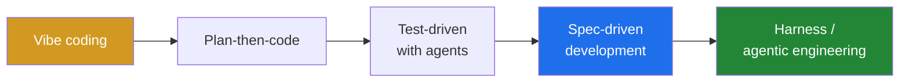
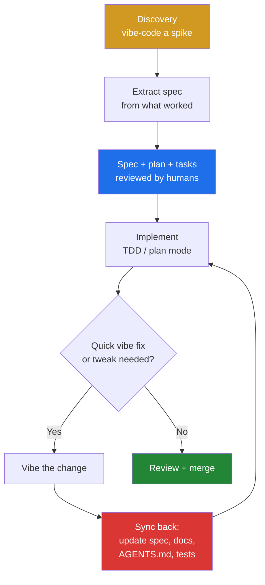

# Vibe Coding, Spec-Driven Development and the Hybrid in Between

LLMs and coding agents gave us a new set of working styles in less than two years. They mostly sit between two poles: **vibe coding** (prompt, accept, run, repeat) and **spec-driven development** (write the spec first, let agents implement it). Neither is right everywhere.

This post covers the main paradigms with official references, then the part that matters in practice: **combining them per phase, and feeding vibe-coded changes back into the specs.**

---

## The Spectrum



From left to right: more structure and more upfront cost, and more confidence in the result.

---

## 1. Vibe Coding

**Origin:** Andrej Karpathy, February 2025: *"fully give in to the vibes, embrace exponentials, and forget that the code even exists."* Collins Dictionary made it the Word of the Year for 2025.

**What it is:** you describe outcomes in natural language, accept the diff without reading it closely, run it, and paste errors back in. The code is disposable.

| Good for | Bad for |
|---|---|
| Prototypes, demos, spikes | Production systems |
| Throwaway scripts and internal tools | Security-sensitive code |
| Exploring an unfamiliar API or UI idea | Anything another team must maintain |
| Learning what you *actually* want | Large existing codebases |

Simon Willison's distinction matters here: if you review, test and understand the code, [it isn't vibe coding](https://simonwillison.net/2025/Mar/19/vibe-coding/). It's just programming with an LLM.

---

## 2. Plan-Then-Code (Explore → Plan → Code → Commit)

This is the default workflow Anthropic recommends in the [Claude Code best practices](https://code.claude.com/docs/en/best-practices):

1. **Explore**: the agent reads the relevant files and makes no edits (plan mode).
2. **Plan**: it writes a plan, and you review and edit it.
3. **Code**: it implements against the plan.
4. **Commit**: it writes the commit and PR description.

The guide also says to skip the plan when you can describe the diff in one sentence. Most tools have this built in now: Claude Code plan mode, Cursor plan mode, Copilot agent mode.

---

## 3. Test-Driven Development with Agents

TDD fits agents well because a failing test is a goal the agent can check by itself:

1. Ask the agent to write tests from the expected behaviour, and tell it **not** to implement anything yet.
2. Confirm the tests fail. Commit them.
3. Ask it to make them pass **without changing the tests**.

Kent Beck calls this [augmented coding](https://tidyfirst.substack.com/p/augmented-coding-beyond-the-vibes). You still care about code quality, tests and design, while the agent does the typing. Watch for agents that "fix" tests by deleting or weakening assertions.

---

## 4. Spec-Driven Development (SDD)

The spec, not the prompt, is the source of truth. Agents turn it into a plan, then tasks, then code.

Birgitta Böckeler's [article on martinfowler.com](https://martinfowler.com/articles/exploring-gen-ai/sdd-3-tools.html) defines three levels:

| Level | Meaning |
|---|---|
| **Spec-first** | Write a spec, generate code, and the spec may be dropped afterwards |
| **Spec-anchored** | The spec is kept and evolved together with the code |
| **Spec-as-source** | Only the spec is edited and the code is fully generated (still mostly an aspiration) |

### The well-documented tools

| Tool | Workflow / artifacts | Fit |
|---|---|---|
| **[GitHub Spec Kit](https://github.com/github/spec-kit)** | `constitution → specify → plan → tasks → implement` as agent slash commands; `spec.md`, `plan.md`, `tasks.md` per feature | Greenfield features; works with Copilot, Claude Code, Gemini CLI and others |
| **[Kiro](https://kiro.dev/docs/specs/)** (AWS) | `.kiro/specs/<feature>/requirements.md` (EARS notation) → `design.md` → `tasks.md` | IDE-integrated, structured requirements |
| **[OpenSpec](https://github.com/Fission-AI/OpenSpec)** | Change proposals with **spec deltas**, archived into living specs | Brownfield, changes to existing systems |
| **[BMAD Method](https://github.com/bmad-code-org/BMAD-METHOD)** | Agent personas (Analyst, PM, Architect, Scrum Master, Dev, QA) producing a PRD, architecture and stories | Larger, agile-style projects |
| **[AWS AI-DLC](https://aws.amazon.com/blogs/devops/ai-driven-development-life-cycle/)** | Inception → Construction → Operations, with human approval gates | Team- and organisation-level methodology |
| **[Tessl](https://tessl.io/)** | Explores spec-as-source | Experimental |

EARS ("Easy Approach to Requirements Syntax") in one line:

```text
WHEN a user submits the form with an invalid email
THE SYSTEM SHALL show an inline error and keep the entered values
```

**Known downsides.** Thoughtworks puts SDD in *Assess* on its [Technology Radar](https://www.thoughtworks.com/radar/techniques/spec-driven-development). Böckeler found the tools too heavy for small changes: a small bug can turn into a pile of user stories. Spec-as-source also inherits the old Model-Driven Development risks, now with a non-deterministic compiler.

---

## 5. Context Engineering

The agent can only follow what it can see. [Anthropic defines context engineering](https://www.anthropic.com/engineering/effective-context-engineering-for-ai-agents) as curating the *whole* context the model gets: instructions, tools, files and history. That set should stay small and high-signal.

In practice this means:

- **[AGENTS.md](https://agents.md/)**, an open format under the Linux Foundation, plus `CLAUDE.md`, Copilot instructions and Kiro steering for project rules.
- Short, current docs that the agent loads on demand.
- Fresh sessions per task, so old context doesn't pile up.

---

## 6. Harness Engineering / Agentic Engineering

- **Agentic engineering** is Karpathy's 2026 term for professional, agent-orchestrated development. You rarely write code directly and act as the oversight. Simon Willison had earlier called the same idea [vibe engineering](https://simonwillison.net/2025/Oct/7/vibe-engineering/).
- **Harness engineering** comes from [OpenAI's Codex team](https://openai.com/index/harness-engineering/) (February 2026). Engineers design the *environment* agents work in: linters, architectural rules, tests and feedback loops whose error messages tell the agent how to fix things. Context engineering decides what the agent **sees**. Harness engineering decides what the system **prevents and corrects**.

---

## Side by Side

| | Vibe | Plan-then-code | TDD + agent | Spec-driven | Harness |
|---|---|---|---|---|---|
| Upfront cost | None | Low | Medium | High | High (once) |
| Speed to first result | Fastest | Fast | Medium | Slow | Fast after setup |
| Reviewability | Poor | Good | Good | Very good | Very good |
| Survives team handover | No | Partly | Yes | Yes | Yes |
| Source of truth | Chat history | Plan | Tests | Spec | Rules + tests + docs |
| Best phase | Discovery | Daily changes | Core logic | Features, contracts | Scaling agent usage |

---

## The Hybrid: Pick the Mode per Phase, Keep One Truth

In practice nobody stays in one mode. A pattern that works well:



| Phase | Mode | Why |
|---|---|---|
| Idea / discovery | **Vibe** | Cheapest way to learn what you actually want |
| Feature definition | **Spec-driven** | Review intent before any code exists |
| Core implementation | **TDD / plan mode** | Behaviour you can check, small diffs |
| UI polish, small fixes, experiments | **Vibe** (on a branch) | Speed where the risk is low |
| After *any* vibe change | **Sync back** | Keeps the spec true |
| Scaling across a team | **Harness** | Rules enforced by machines, not memory |

### The rule that makes it work: sync back

Vibe coding's real cost is **spec drift**. The code quietly stops matching the documents, and the next agent session, which reads those documents, builds on false information. So every vibe change ends with a reconciliation step:

```text
Compare the changes on this branch with specs/<feature>/ and AGENTS.md.
Update requirements, design notes and tasks to reflect what the code now does.
List any behaviour that is in the code but not in the spec, and vice versa.
Do not change code in this step.
```

Concrete habits:

- **Spike → spec → rebuild.** Treat the vibe prototype as research. Extract the spec from it, then rebuild properly. Don't promote the spike to production.
- **Spec deltas in the same PR.** Code and spec change together, the way OpenSpec does with change folders. A PR that changes behaviour without touching the spec is incomplete.
- **Tests as the anchor.** If a vibe change alters behaviour, a test must change too. Tests are the part of the spec that can be executed.
- **Drift checks in review or CI.** Have an agent or a checklist item ask: *"Does the spec still describe this code?"*
- **Keep context files lean.** Sync back means *correcting* the docs, not appending to them forever.

### Why the hybrid beats either extreme

- **Speed where it's safe, rigour where it matters.** You don't pay spec overhead on a colour change, and you don't vibe code a payment flow.
- **Specs stay alive.** Spec-first docs usually rot once the feature ships. Syncing back after every change gives you spec-anchored development in practice.
- **Better agent output over time.** Accurate specs and `AGENTS.md` are the context the next session depends on. Drift compounds, and so does accuracy.
- **Reviewable intent.** Reviewers compare the spec delta with the code delta instead of reverse-engineering intent from a diff.
- **Cheap discovery without lock-in.** Vibe spikes answer "is this the right thing?" before the spec commits you to it.

---

## Anti-Patterns

- **Vibe to production.** A prototype that ships without review or tests.
- **Spec theatre.** A 16-criteria spec for a one-line fix. Scale the process to the change, as AI-DLC and Claude Code's "skip the plan" advice both recommend.
- **Write-only specs.** Generated once and never read or updated again.
- **Obese context files.** An `AGENTS.md` that only ever grows, and gets worse with every addition.
- **Agents grading their own homework.** Letting the implementing agent edit the tests it is supposed to pass.

---

## References

- Andrej Karpathy, [original "vibe coding" post](https://x.com/karpathy/status/1886192184808149383) (Feb 2025)
- Simon Willison, [Not all AI-assisted programming is vibe coding](https://simonwillison.net/2025/Mar/19/vibe-coding/) · [Vibe engineering](https://simonwillison.net/2025/Oct/7/vibe-engineering/)
- Anthropic, [Claude Code best practices](https://code.claude.com/docs/en/best-practices) · [Effective context engineering for AI agents](https://www.anthropic.com/engineering/effective-context-engineering-for-ai-agents)
- Kent Beck, [Augmented Coding: Beyond the Vibes](https://tidyfirst.substack.com/p/augmented-coding-beyond-the-vibes)
- Birgitta Böckeler (martinfowler.com), [Understanding Spec-Driven Development: Kiro, spec-kit, and Tessl](https://martinfowler.com/articles/exploring-gen-ai/sdd-3-tools.html)
- Thoughtworks Technology Radar, [Spec-driven development](https://www.thoughtworks.com/radar/techniques/spec-driven-development)
- GitHub, [Spec Kit](https://github.com/github/spec-kit) · Kiro, [Specs docs](https://kiro.dev/docs/specs/) · [OpenSpec](https://github.com/Fission-AI/OpenSpec) · [BMAD Method](https://github.com/bmad-code-org/BMAD-METHOD)
- AWS, [AI-Driven Development Life Cycle](https://aws.amazon.com/blogs/devops/ai-driven-development-life-cycle/)
- OpenAI, [Harness engineering: leveraging Codex in an agent-first world](https://openai.com/index/harness-engineering/)
- [AGENTS.md](https://agents.md/)
